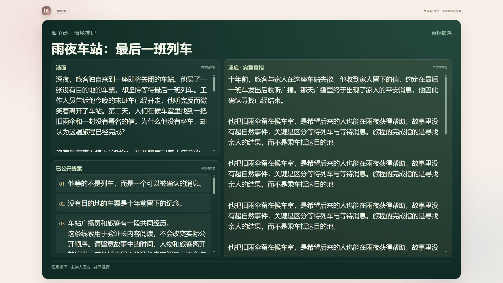
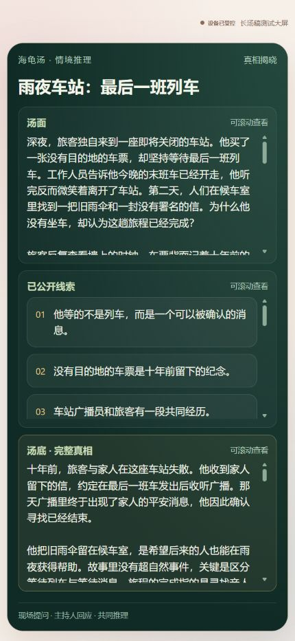
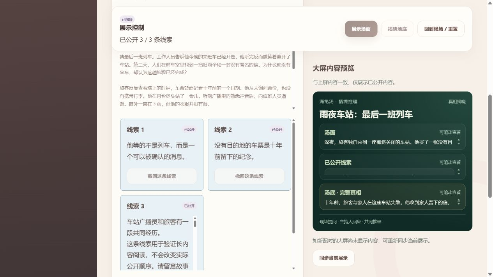

# 海龟汤长内容显示调整

## 如何使用

无需新增设置。展示汤面后，大屏会根据实际区域宽度安排内容：没有公开线索时汤面使用整个内容区；公开线索后，横屏将汤面和线索并排展示。揭晓汤底后，完整真相使用右侧的大区域，汤面和线索保留在左侧。窄屏自动改为上下排列。

内容稍长时会适当缩小文字，最多缩小约 18%。更长的内容保留可读字号，只在对应区域内滚动，标题、分区名称和底部提示保持可见。需要自动播放长内容时，可继续使用原有大屏设备的自动滚动、滚动位置和字号设置。

主持人端的展示按钮在宽屏上保持可见，预览与按钮错开，避免遮挡。汤面、线索卡片和主持人参考汤底各自限制阅读区域的高度。点击“本会场使用的汤稿”可以展开选稿，点击“编辑当前汤稿（仅本会场）”可以展开修改区域。修改和切换仍须先回到候场。

## 验证记录

- 本地测试了 1280×720、1920×1080 大屏与 430×932 窄屏。
- 7500 字汤面、8000 字汤底、2000 字线索均只在各自分区内滚动，窄屏页面没有横向或纵向溢出。
- 短汤稿恢复原字号，隐藏滚动提示。
- 验证了 150% 字号、指定滚动位置和自动滚动；测试后恢复默认设备设置。
- 46 项现有前端测试通过，生产构建成功。未修改线上数据或部署。

最新替换包：`output/frontend-latest.zip`。替换方法见 `docs/前端替换说明.md`。
