# 知识挑战赛完整图文操作手册

版本日期：2026 年 10 月 6 日。截图来自当前版本的本地演示环境。

每次操作前先确认会场名称。点击图片可查看原图。前端更新另见《前端替换说明》。

## 目录

1. [先看这一页：今天你要做什么](#操作-1)
2. [登录后台](#操作-2)
3. [认识母活动和会场](#操作-3)
4. [选择自己的会场](#操作-4)
5. [活动管理列表](#操作-5)
6. [创建母活动](#操作-6)
7. [创建会场并开启功能](#操作-7)
8. [修改会场功能和基本信息](#操作-8)
9. [普通答题和固定比例计分](#操作-9)
10. [按排名计分](#操作-10)
11. [题库页面和十题分页](#操作-11)
12. [按标题内容或答案搜索](#操作-12)
13. [翻到第二页核对题目](#操作-13)
14. [新增和修改单选题](#操作-14)
15. [新增和修改多选题](#操作-15)
16. [文本题和给分方式](#操作-16)
17. [题目媒体和答案材料](#操作-17)
18. [模板下载和批量导入](#操作-18)
19. [会场选择同步总题库题目](#操作-19)
20. [会场同步整个题组](#操作-20)
21. [新建题组和安排顺序](#操作-21)
22. [随机排序和下发题组](#操作-22)
23. [文本题人工评分列表](#操作-23)
24. [人工给分和反馈](#操作-24)
25. [答题控场准备和开始](#操作-25)
26. [开题计时和最近提交](#操作-26)
27. [公布答案和切换下一题](#操作-27)
28. [发布积分榜和确认获奖](#操作-28)
29. [抢答模式主持人操作](#操作-29)
30. [参与者名册搜索](#操作-30)
31. [修改参与者和调整积分](#操作-31)
32. [母活动海龟汤汤稿库](#操作-32)
33. [新增和修改汤稿](#操作-33)
34. [会场选用多个汤稿](#操作-34)
35. [海龟汤开始与展示汤面](#操作-35)
36. [自由公开和撤回线索](#操作-36)
37. [临时添加现场线索](#操作-37)
38. [会场本地编辑汤稿](#操作-38)
39. [揭晓汤底前的确认](#操作-39)
40. [切换下一份汤稿](#操作-40)
41. [海龟汤公开线索大屏](#操作-41)
42. [海龟汤观众大屏](#操作-42)
43. [长汤稿自动分页播放](#操作-43)
44. [手机或窄屏怎么看海龟汤](#操作-44)
45. [主持人怎么避免来回翻页面](#操作-45)
46. [主持人远程控制翻页](#操作-46)
47. [奖池列表与库存](#操作-47)
48. [创建和配置奖池](#操作-48)
49. [人工发放奖品](#操作-49)
50. [按排行发奖](#操作-50)
51. [抽奖入口和授予机会](#操作-51)
52. [开始抽奖环节](#操作-52)
53. [主持人摇奖准备](#操作-53)
54. [开始摇奖和公布中奖人](#操作-54)
55. [认识核销台和领取记录](#操作-55)
56. [核销台逐项和批量核销](#操作-56)
57. [大屏管理和模板列表](#操作-57)
58. [注册大屏和安全配对](#操作-58)
59. [配对结果与重新配对](#操作-59)
60. [字号音量滚动与设备名称](#操作-60)
61. [管理和重命名大屏](#操作-61)
62. [新建大屏内容模板](#操作-62)
63. [大屏候场报名二维码](#操作-63)
64. [大屏报名二维码和答题展示](#操作-64)
65. [大屏公布答案](#操作-65)
66. [报名入口配置](#操作-66)
67. [扩展报名字段](#操作-67)
68. [会场成员授权](#操作-68)
69. [新增工作人员账号](#操作-69)
70. [编辑账号和密码](#操作-70)
71. [站点基础和参与端品牌](#操作-71)
72. [素材存储设置](#操作-72)
73. [玩家公共会场选择页](#操作-73)
74. [玩家选择会场和报名](#操作-74)
75. [已登记身份查询和退出](#操作-75)
76. [玩家选择会场功能](#操作-76)
77. [玩家等待主持人开题](#操作-77)
78. [玩家普通答题](#操作-78)
79. [玩家查看答题结果](#操作-79)
80. [玩家文本题](#操作-80)
81. [玩家抢答](#操作-81)
82. [玩家查看积分榜](#操作-82)
83. [玩家查看我的信息](#操作-83)
84. [玩家查看暂无奖励的状态](#操作-84)
85. [玩家奖励和自助抽奖](#操作-85)
86. [结束活动和保留记录](#操作-86)
87. [查看手册和排查问题](#操作-87)

## 01 先看这一页：今天你要做什么

不用从头背完整本手册。先找到自己负责的事情，再按目录跳到对应章节。

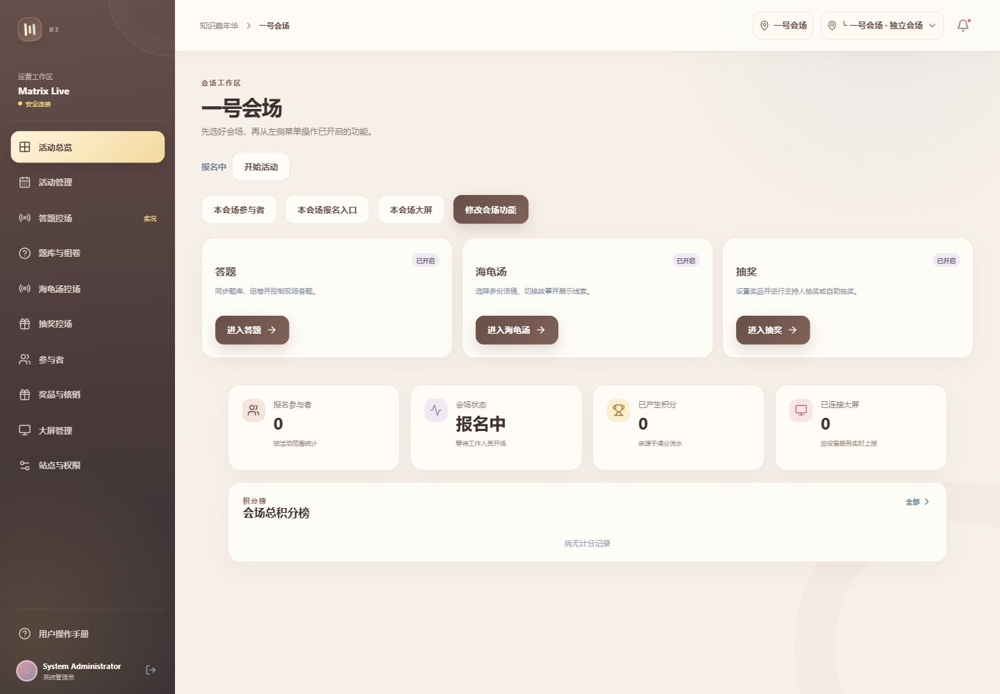

1. 负责准备：看“登录后台”“创建母活动”“创建会场”，再准备题库、汤稿、奖品和工作人员账号。
2. 负责主持：先选自己的会场。答题看答题控场章节；海龟汤看“海龟汤开始与展示汤面”；抽奖看抽奖控场章节。
3. 负责大屏：看大屏设备管理和配对章节。投影给观众的是大屏页面，主持人的后台留在工作人员电脑上。
4. 负责参加：直接看“玩家”章节。手机扫描会场二维码，核对名称，再按页面登记或答题。

完成后：每次动手前先看会场名称；点保存后等成功提示，不要连续重复点。

## 02 登录后台

准备好管理员提供的网址、工作账号和密码。工作人员和观众使用不同入口。

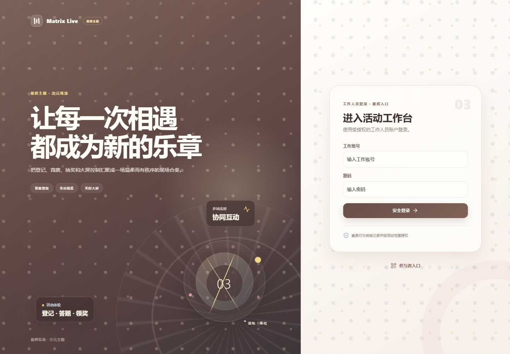

1. 双击浏览器图标。在最上方地址栏输入后台网址，按回车；示例网站的后台入口是 https://match.soyorin.love/login。
2. 点“工作账号”输入自己的账号，再点“密码”输入密码。注意大小写，不要在前后加空格。
3. 点“安全登录”，等待活动总览出现。出现错误时按提示重新核对；不知道账号或密码时联系管理员。
4. 使用共用电脑时，结束工作后点左下角“退出登录”。不要把工作人员账号发给观众。

完成后：进入活动总览后，先确认上方工作范围，再操作左侧菜单。

## 03 认识母活动和会场

母活动保存公共资料，会场才是报名和现场操作的单位。

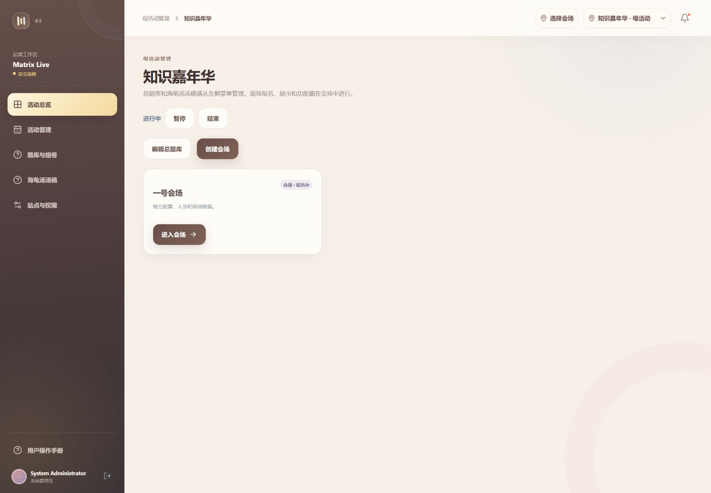

1. 母活动例如“知识嘉年华”：保存总题库、题组和海龟汤汤稿。母活动不用于观众报名，也不作为观众大屏入口。
2. 会场例如“一号会场”：保存独立配置、报名名单、积分、奖品和大屏。不同会场的现场数据分别管理。
3. 创建会场时直接勾选答题、海龟汤、抽奖。无需再创建带“子活动”标签的项目。
4. 准备公共题目和故事时选母活动；现场开题、展示、抽奖时选会场。

完成后：母活动侧边栏能看到总题库和海龟汤汤稿；现场功能在会场侧边栏。

## 04 选择自己的会场

上方选工作范围，左侧选要做的事情。每次换页面都先看会场名称。

1. 点上方“选择会场”的下拉框，再点自己的会场名称。若菜单中没有你的会场，请联系管理员分配权限。
2. 需要准备母活动资料时，在“选择母活动或会场”中点带“母活动”的项目。
3. 会场总览显示三项功能和“已开启／未开启”。点已开启功能的“进入”按钮，或点左侧相应菜单。
4. 同一会场有历史功能记录时，按页面提供的记录选项查看旧记录；新会场仍按勾选功能使用。

完成后：页头名称应与实际负责的会场一致。不要在其他会场尝试开题或发奖。

## 05 活动管理列表

在这里创建和修改活动，也能查看每个母活动及会场的状态。

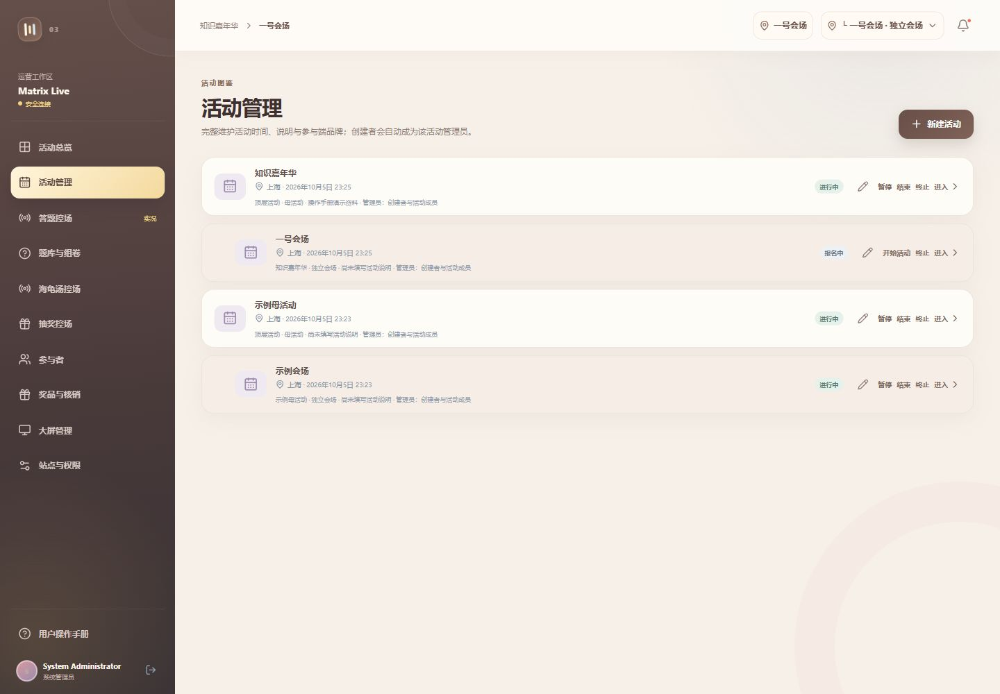

1. 左侧点“活动管理”。每一行显示名称、上级、类型、时间和状态。
2. 点“新建活动”打开创建窗口。已有项目需要修改时，点该行的铅笔形“编辑活动”。
3. 点该行“进入”切换到对应项目。开始、暂停、结束等按钮只影响所选行及相关下属范围，请先核对名称。
4. “终止”和“结束”不是暂时休息；关闭后不能重新开场。只是暂时停下时使用“暂停”。

完成后：列表中应能分清母活动和独立会场。

## 06 创建母活动

通常由管理员先创建母活动，再创建所属会场。已有母活动时不必重复建。

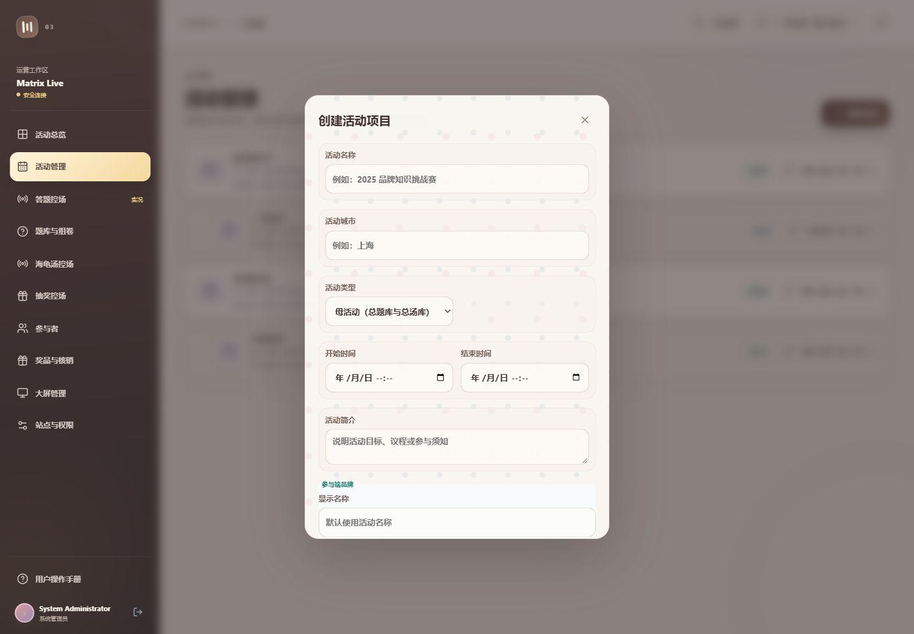

1. 在活动管理点“新建活动”。填写活动名称、城市，活动类型选“母活动（总题库与总汤库）”。
2. 按安排填写开始时间、结束时间和简介。结束时间应晚于开始时间。日期框可点击选择，也可逐项输入。
3. 参与端品牌字段按需要填写；先不设置也可以。检查名称和时间后点“创建并进入配置”。
4. 资料准备好后，在母活动总览点“启用母活动”。所属母活动启用后，会场才能开放报名和现场功能。

完成后：母活动出现在列表中；题库与汤稿从左侧进入，不在总览中直接编辑。

## 07 创建会场并开启功能

会场是独立现场。选错所属母活动会影响后续题库和汤稿来源。

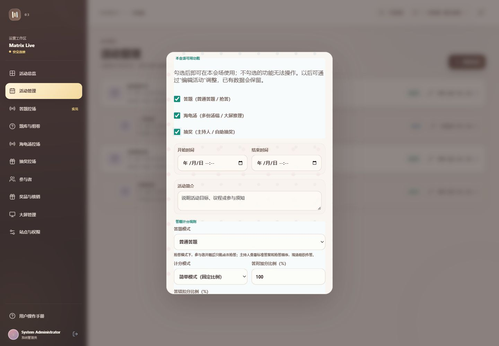

1. 新建活动，填会场名称、城市；类型选“独立会场（报名、展示与数据）”。
2. 在“所属母活动”选正确项目，例如“知识嘉年华”。保存前核对，创建后不要把会场当作可随意搬动的标签。
3. 在“本会场可用功能”勾选需要的答题、海龟汤、抽奖。出现勾号才表示开启，可以只开一项。
4. 需要答题时同时设置答题模式、计分规则；点“创建并进入配置”。先准备资料，再启用报名或开始活动。

完成后：会场总览和侧边栏出现已勾选功能的入口。

## 08 修改会场功能和基本信息

新建和编辑使用同一套字段；编辑窗口的保存按钮为“保存活动”。

1. 在活动管理找到正确会场，点该行“编辑活动”。修改名称、说明、时间或品牌字段。
2. 勾选功能表示允许使用；取消勾选表示关闭入口。已有数据保留，重新勾选后可继续查看。
3. 改答题模式前先关闭正在答的题目。正式开场前确认计分规则，避免活动中途改变规则。
4. 点“保存活动”并等待成功。关闭窗口或切换页面前保存；不保存的修改不会生效。

完成后：总览中功能开关和菜单入口与保存的选择一致。

## 09 普通答题和固定比例计分

“答题模式”决定玩家如何参与，“计分模式”决定如何加分扣分。

1. 普通答题：玩家在手机上选择答案或输入文字，点击确认提交。单选、多选、文本题分别按题目规则处理。
2. 简单模式：填写“答对加分比例”和“答错扣分比例”。例如题目 100 分、答对 100%、答错 0%，正确加 100 分，错误不扣分。
3. 答错扣分比例是扣减，不是给错误答案加分；例如满分 100、扣分 20%，错误扣 20 分。
4. 多选的部分得分在题目编辑窗口另行设置。准备阶段检查规则，保存后再进行试答。

完成后：规则应与主持人对观众宣布的一致。

## 10 按排名计分

一般模式可按提交排名区间设置比例，适合先答和后答分值不同的活动。

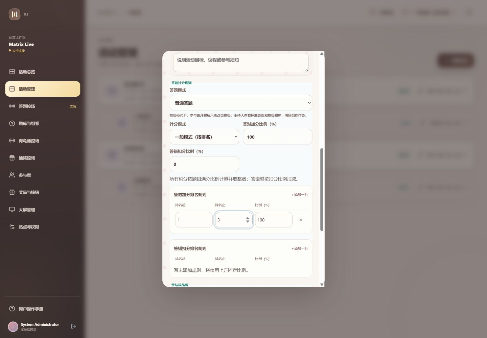

1. 在会场编辑窗口将“计分模式”选为“一般模式（按排名）”。
2. 点“添加答对加分排名规则”，填写排名起、排名止和比例；例如第 1 至 3 位 100%，第 4 至 10 位 80%。
3. 需要答错扣分排名规则时同样添加。区间起点不能大于终点，比例按页面范围填写。
4. 未匹配排名规则时使用上方固定比例。检查区间和默认比例后保存，并在正式活动前试答。

完成后：工作人员应知道各排名区间和未匹配时的比例。

## 11 题库页面和十题分页

母活动是公共题库，会场题库是本会场准备的副本。

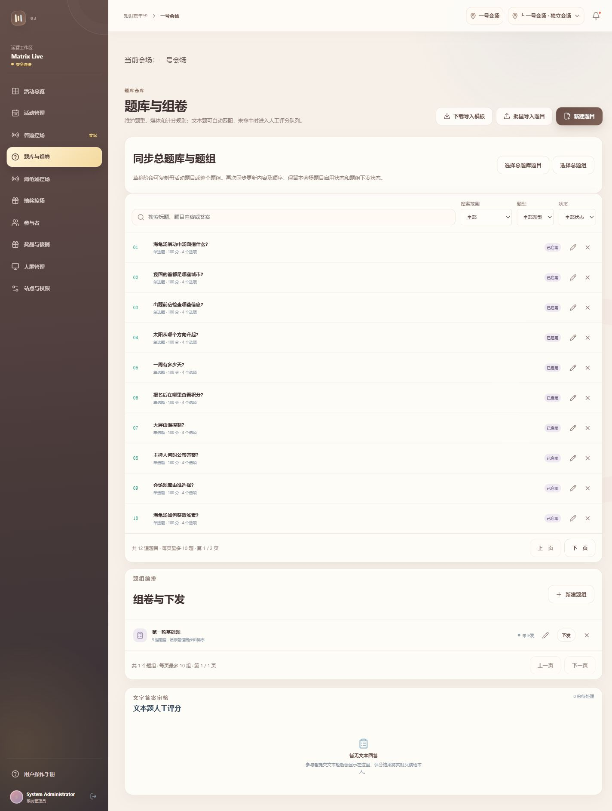

1. 先选母活动或会场，再点左侧“题库与组卷”。页头范围不同，操作的资料也不同。
2. 每页最多显示十道题。列表下方显示总数和第几页，点“下一页／上一页”翻页。
3. 题目行显示题型、分值、启用状态；铅笔按钮修改该题，垃圾桶按钮删除该题。删除前核对用途和记录。
4. 页面下方是“组卷与下发”和“文本题人工评分”。使用鼠标滚轮向下查看。

完成后：看到第 1／2 页不代表只有十道题；总数以分页提示为准。

## 12 按标题内容或答案搜索

搜索条件可以组合使用。找不到题时先清空条件再检查。

1. 点“题库搜索”输入关键词。“搜索范围”选标题、题目内容与选项、答案或全部。
2. 例如查找标准答案含“故事中的谜题描述”的题，先选“答案”，再输入这段文字。
3. 需要缩小范围时，题型选单选／多选／文本，状态选已启用／已停用。筛选后自动回到第一页。
4. 清空关键词、将类型和状态改回全部，即可恢复完整列表。题组列表也受页面搜索影响。

完成后：分页总数反映筛选结果；空列表可能是条件过严。

## 13 翻到第二页核对题目

分页用于控制一次显示的数量，不会改变题目本身或出题顺序。

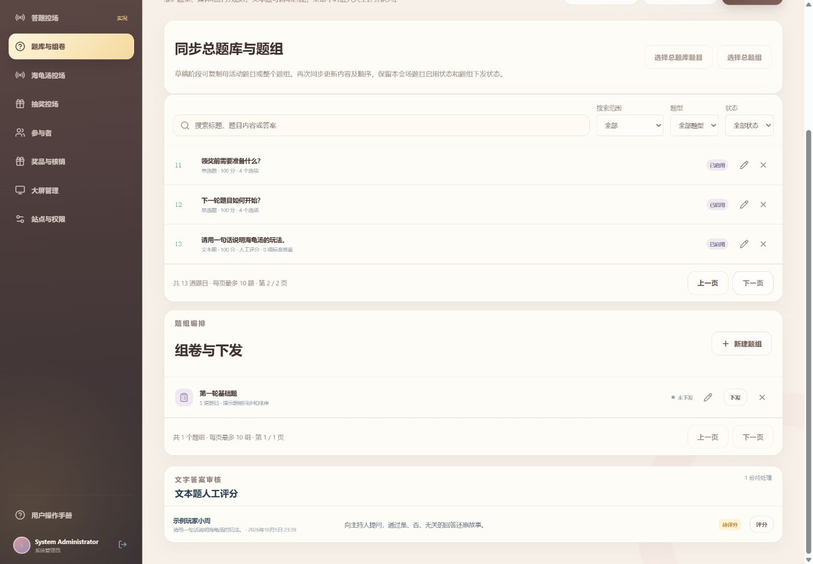

1. 在列表底部点“下一页”。页码变为第 2 页后，查看本页题目。
2. 点“上一页”返回。只有一页时按钮灰色，这是正常现象。
3. 在同步、组卷窗口中翻页不会清除已选项目；“已选”数量会跨页累计。
4. 编辑题目前核对题干，避免只凭序号识别题目；筛选和排序后显示位置可能不同。

完成后：每页题目数不超过十道，跨页选择仍保留。

## 14 新增和修改单选题

单选题只有一个正确答案。题干、选项、答案和分值需要一起核对。

1. 点“新建题目”，题型选“单选”。已有题目点击铅笔按钮进入同类窗口。
2. 填写题干和题目分值。选项框每行写一个选项，不要把多个选项挤在同一行。
3. 正确答案可按页面输入对应选项字母，例如 A；先检查 A 代表的内容确实正确。
4. 勾选“允许在控场中发布”，点“保存题目”。关闭该开关只停用题目，不删除内容。

完成后：保存后列表出现该题，显示正确题型、分值和启用状态。

## 15 新增和修改多选题

多选题允许多个正确选项，部分得分规则需提前说明。

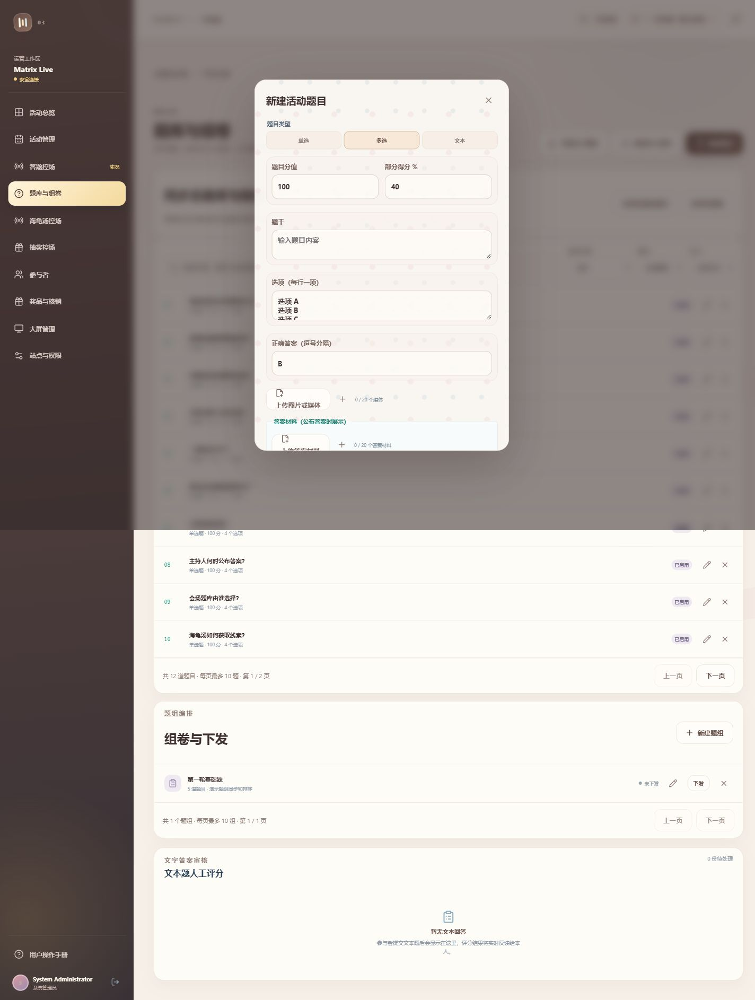

1. 新建题目后点“多选”，填写题干、选项和满分。
2. 在正确答案框用逗号分隔，例如 A, C。不要把答案写到题干里。
3. “部分得分 %”是本题的部分得分比例。根据活动规则填写，再核对选项和标准答案。
4. 勾选是否允许发布，保存后试答一次全对、部分正确和错误的情况。

完成后：题目显示为多选，参与者需要勾选所有认为正确的选项后提交。

## 16 文本题和给分方式

文本题由玩家输入文字。选择匹配方式前先确定判题规则。

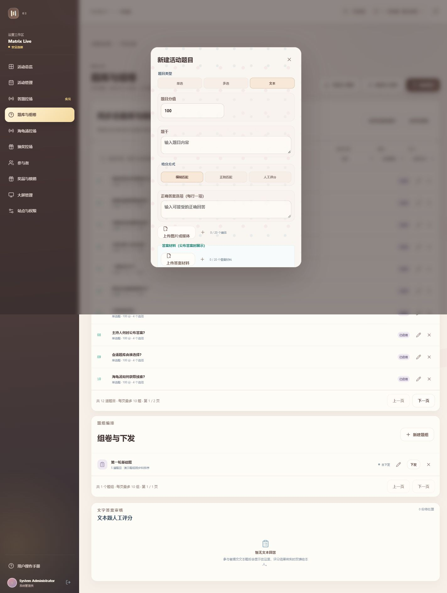

1. 新建题目选“文本”，填写题干和满分。
2. “模糊匹配”：在“正确答案选项”每行填写一个可接受答案；未命中回答可能进入人工评分。
3. “正则匹配”：按规则表达式判题，建议交给熟悉规则的资料管理员，先试答后使用。
4. “人工评分”：不依赖自动答案，工作人员收到文字回答后给分。保存题目后，在下面的人工评分区处理。

完成后：文字回答的实际规则与选择的给分方式一致。

## 17 题目媒体和答案材料

题面素材与答案素材用途不同，公布时机也不同。

1. “上传图片或媒体”用于题目本身的图片、音频或视频；“添加媒体地址”用于填写素材链接。
2. “答案材料”用于公布答案时展示的内容，避免提前把答案素材放在题面素材里。
3. 每类最多二十个素材。上传受服务器大小限制；当前默认单文件上限约 20MB。
4. 需要上传时由管理员配置存储服务。素材加入后保存题目，再在大屏预览中确认能显示或播放。

完成后：手机和大屏能正常加载题面素材，答案材料在公布答案时出现。

## 18 模板下载和批量导入

批量导入适合已有整理好的资料。第一次先少量导入。

1. 点“下载导入模板”，找到 question-bank-template.csv，用 Excel 或 WPS 打开。保留第一行列名，替换下面的示例题目。
2. 每行一道题。单选填 SINGLE，多选填 MULTIPLE，文本填 TEXT；选项用两根竖线 || 分隔，多选答案例如 A,C。保存为 CSV UTF-8，不要只改文件扩展名。
3. 点“批量导入题目”，选择整理好的 CSV 文件并打开；每次最多 500 题。按提示中的行号修正错误，确认后重新导入。
4. 检查导入后的题数、分值、选项、正确答案和启用状态，再组卷。不要在正式开题时临时导入大量题目。

完成后：导入结果和题库列表一致；失败时先检查文件内容和格式。

## 19 会场选择同步总题库题目

同步将母活动资料复制到本会场。只同步所选项目，不删除未选的旧题。

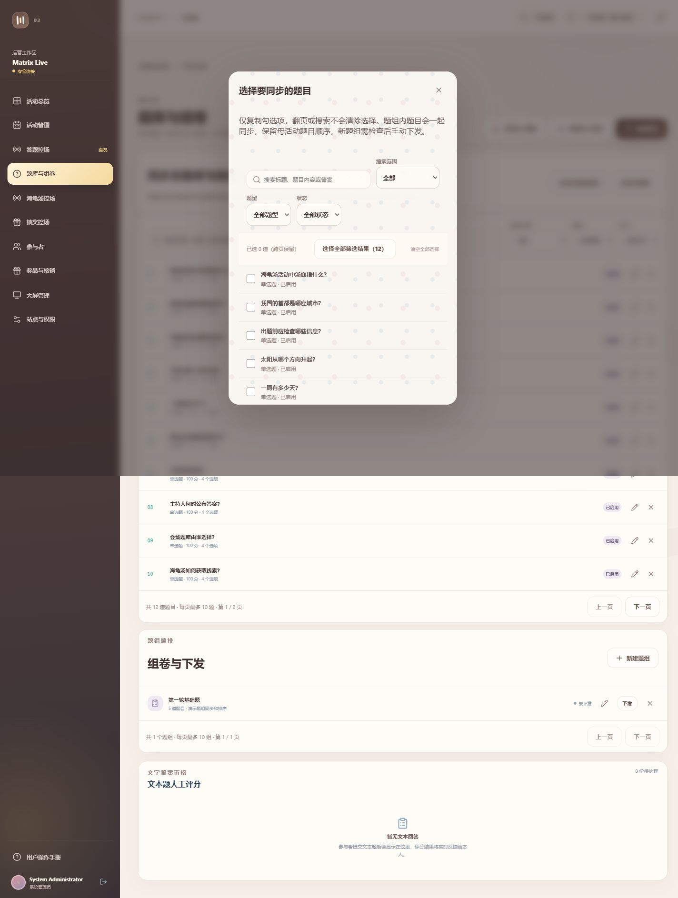

1. 选会场，打开题库；答题功能应开启且仍处于草稿。点“选择总题库题目”。
2. 用搜索范围、题型和状态找题，在要使用的题目前打勾。翻页和搜索保留原有选择。
3. “选择全部筛选结果”选择的是所有符合条件的题，可能跨多页；“清空全部选择”会取消全部已选项。
4. 核对“已选”数量，点“同步所选题目”。再次同步会更新来源内容，但保留本会场启停状态。

完成后：成功后会场题库出现所选题。同步按钮灰色时检查权限和答题草稿状态。

## 20 会场同步整个题组

需要复制一整轮题目和顺序时，使用题组同步。

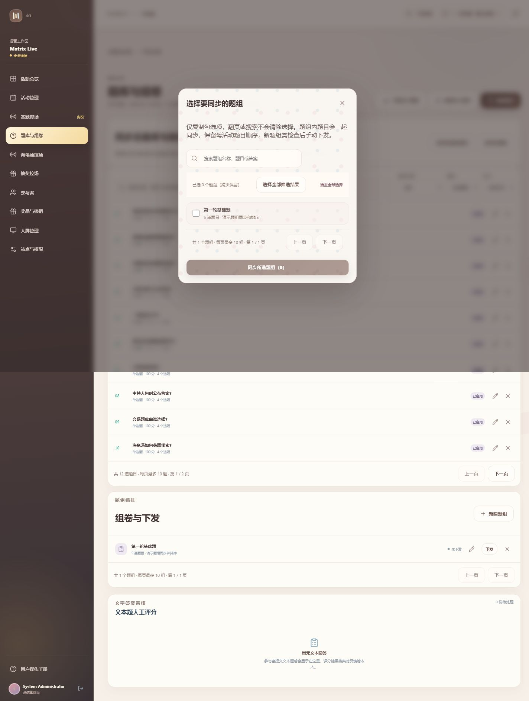

1. 在会场题库点“选择总题组”。输入名称或说明查找母活动题组。
2. 勾选需要的题组；题组包含的题目会一起复制，无需逐道再次勾选。
3. 点“同步所选题组”。母活动顺序会复制到会场；再次同步更新内容及顺序，保留会场题目启用和已有题组下发状态。
4. 新同步题组先检查题目和顺序，再手动下发。母活动后续修改不会未经同步就自动覆盖会场。

完成后：会场下方题组列表出现所选题组；只有下发后才作为本轮出题集合。

## 21 新建题组和安排顺序

题库是全部资料，题组是这一轮实际使用的题目。

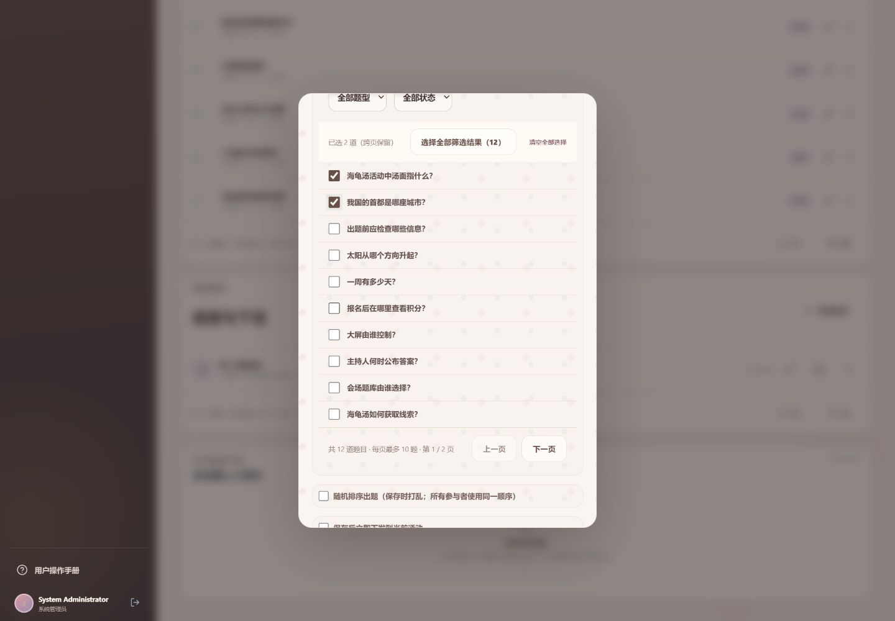

1. 在“组卷与下发”点“新建题组”，填写名称和说明，例如“第一轮基础题”。
2. 在下面勾选题目，可搜索和翻页。上方“题目顺序”列出已选题。
3. 点“上移／下移”安排固定顺序。取消勾选可移出本题组，但不会删除题库中的原题。
4. 检查题数和顺序后点“保存题组”。未下发的题组只是准备资料。

完成后：题组列表显示名称、题数和是否下发。

## 22 随机排序和下发题组

随机排序在保存时生成一次，所有参与者使用相同顺序。

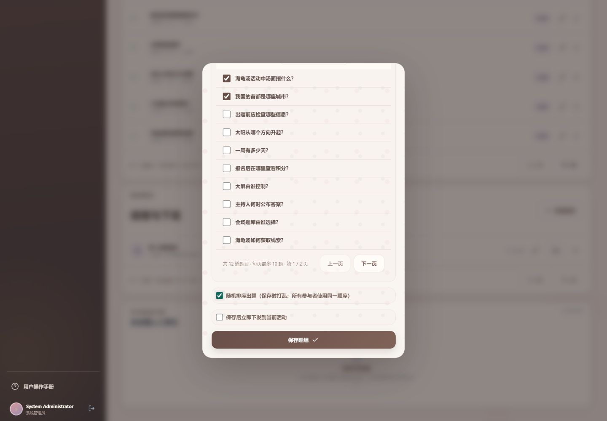

1. 在题组窗口勾“随机排序出题”。保存时打乱所选题目；刷新页面不会再次打乱。
2. 只有一道题时无法看出排序变化。固定顺序的题组不要勾选随机排序。
3. 要立即使用本题组，勾“保存后立即下发到当前活动”，再保存；也可保存后点列表中的“下发”。
4. 下发后检查“当前下发”标记，并在控场题目列表检查实际题目。换轮次时选下一轮题组下发。

完成后：控场和参与端使用已下发题组；它决定本轮题目集合和顺序。

## 23 文本题人工评分列表

文字题不应凭提交数量判断已经得分。待评分需要工作人员处理。

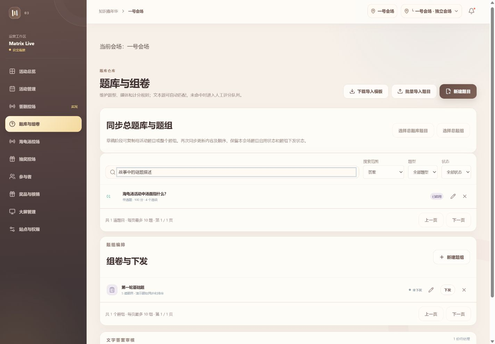

1. 进入题库，向下找到“文本题人工评分”。查看待处理数量、参与者、题目和实际回答。
2. 逐条阅读回答，再点该条“评分”。不要只根据参与者名字或排名给分。
3. 若列表没有记录，先确认会场、文本题是否已经开题、玩家是否提交成功。
4. 页面搜索可能影响题组和题目显示，但人工评分仍按当前会场功能加载。

完成后：待评分的回答有明确记录和评分入口。

## 24 人工给分和反馈

评分会改变积分并反馈给玩家，提交前核对题目满分。

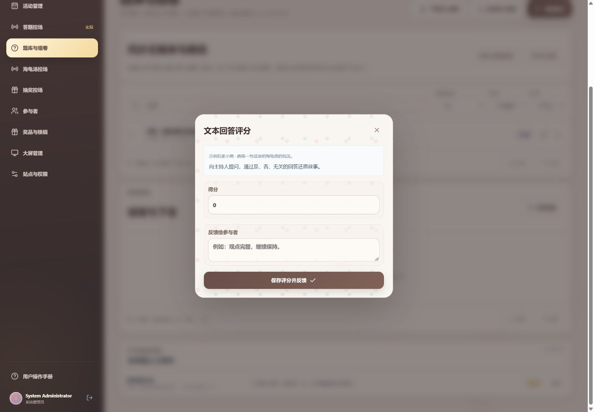

1. 在评分窗口阅读参与者回答。按活动评分标准填写“得分”，不得超过题目允许范围。
2. 需要说明原因时填写“反馈给参与者”，例如“已正确说明提问规则，得 80 分”。
3. 点“保存评分并反馈”，等待成功。不要在正在保存时连续点击。
4. 检查待处理数量、积分榜和玩家反馈是否更新；发现错误时按活动允许的评分调整流程核对。

完成后：该回答不再显示待评分，积分和反馈同步更新。

## 25 答题控场准备和开始

会场开启答题功能后，还要在答题控场开始这一环节。

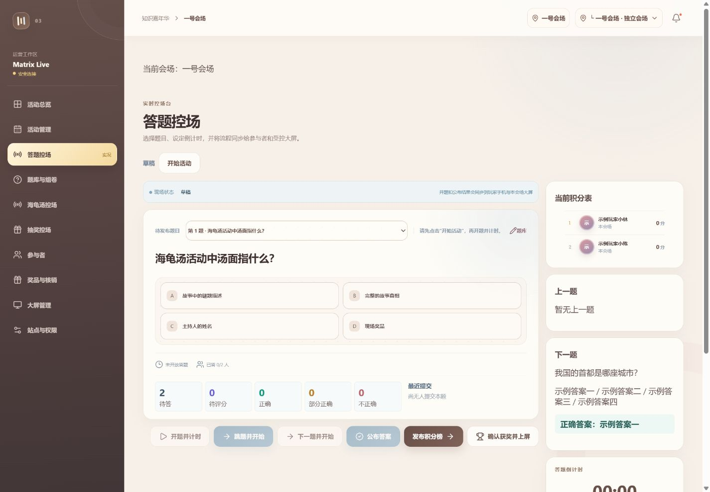

1. 选会场，点“答题控场”。草稿时先检查题目已启用、题组已下发、计分规则和大屏配对。
2. 页头为草稿时点“开始活动”。如果母活动或会场未开放，先由管理员启用上级范围。
3. 在“选择控场题目”选本轮题。右侧查看下一题和标准答案，避免公布或跳过错误题目。
4. “开始活动”仅启用环节，玩家要等“开题并计时”后才能作答。

完成后：现场状态进入等待开始，开题按钮可以使用。

## 26 开题计时和最近提交

主持人选择并发布题目，手机和大屏随后自动更新。

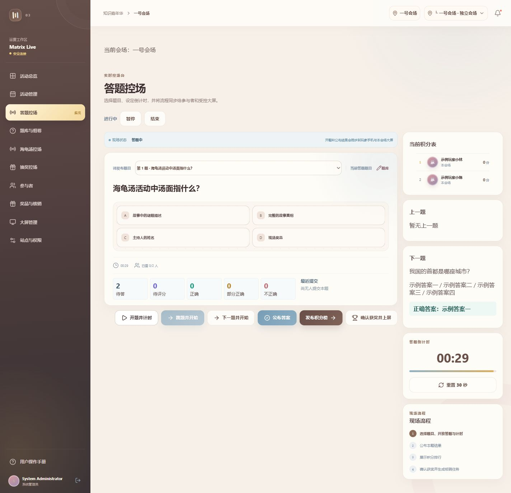

1. 选择题目后点“开题并计时”。默认倒计时可通过“重置 30 秒”调整为该按钮对应时长。
2. 观察倒计时、已答人数和最近提交。普通模式统计正确、部分正确、错误和待评分。
3. 未到截止时间时告诉观众先选答案再确认提交。时间结束后不要要求重新提交本题。
4. 开题期间换题要使用明确的跳题或下一题操作，并提醒现场观众当前题已改变。

完成后：手机出现同一题目和倒计时，大屏显示当前题。

## 27 公布答案和切换下一题

公布答案会关闭本题作答窗口，适合解释答案后进入下一题。

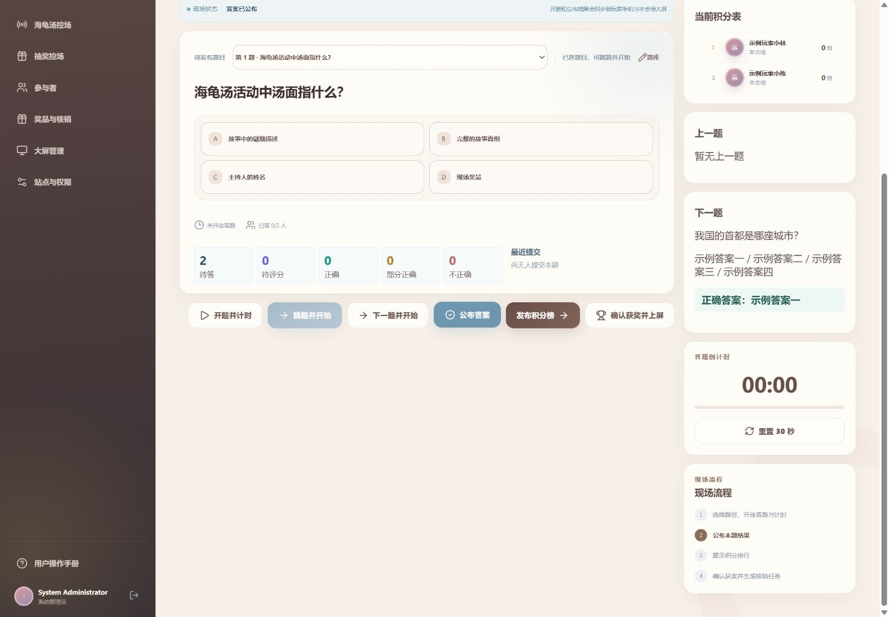

1. 点“公布答案”，大屏显示正确选项及配置的答案材料。玩家可查看公布结果。
2. “下一题并开始”按当前题组顺序进入下一题；“跳题并开始”发布下拉框中另选的题目。
3. 回到已经答过的题目时，先核对是否允许重开及已有记录，避免把重开误当作清空历史。
4. 需要暂时休息时点“暂停”。恢复后重新开题，暂停前的答题窗口不会自动续开。

完成后：大屏提示答案已公布，手机不能再提交本题。

## 28 发布积分榜和确认获奖

先核对积分与待评分，再公开排名和发奖。

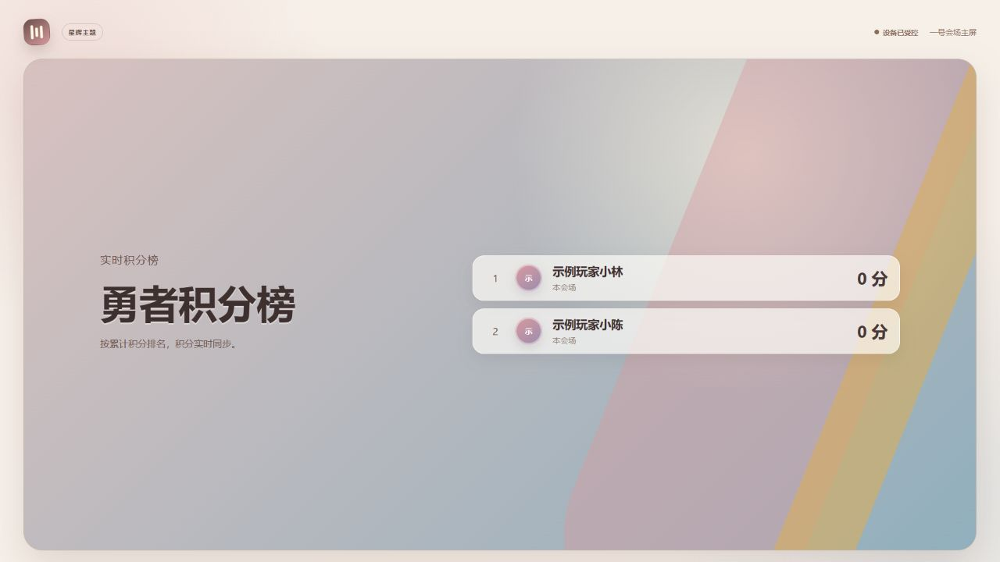

1. 点“发布积分榜”。大屏切换为当前积分排名，手机排行也能查看积分。
2. 检查文本题是否仍待评分、抢答是否仍待判题、人工积分调整是否完成。
3. 排名发奖需要预先配置排名奖池、库存和名次区间。核对后点“确认获奖并上屏”，阅读确认窗口再执行。
4. 没有可发放排名奖池时，不会凭空生成奖品。奖品生成后还要按交付方式领取或核销。

完成后：排行和奖励发放依据已核对的积分，不把待评分结果当作最终排名。

## 29 抢答模式主持人操作

抢答模式的玩家先争取顺序，再由主持人现场组织回答。

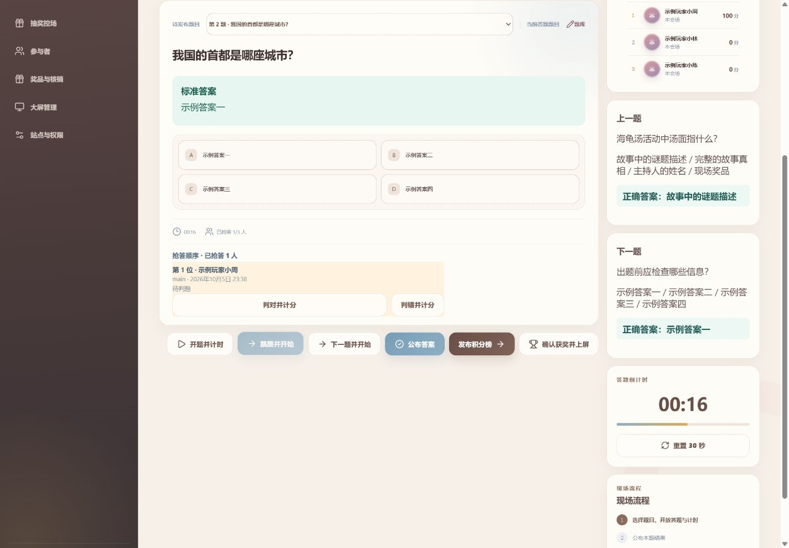

1. 会场答题模式选“抢答模式”。切换前先公布或关闭正在开放的题目。
2. 控场开题后看“抢答顺序”，先到的排在前面。标准答案仅供主持人参考。
3. 按顺序请玩家现场回答。点对应人的“判对并计分”或“判错并计分”，系统按规则更新积分。
4. 已判题后不要重复判同一条。完成本题后公布答案或进入下一题；遇到网络波动先刷新核对。

完成后：主持人能看到玩家顺序和判题状态，手机收到对应积分反馈。

## 30 参与者名册搜索

只查看和处理当前会场的报名人员。

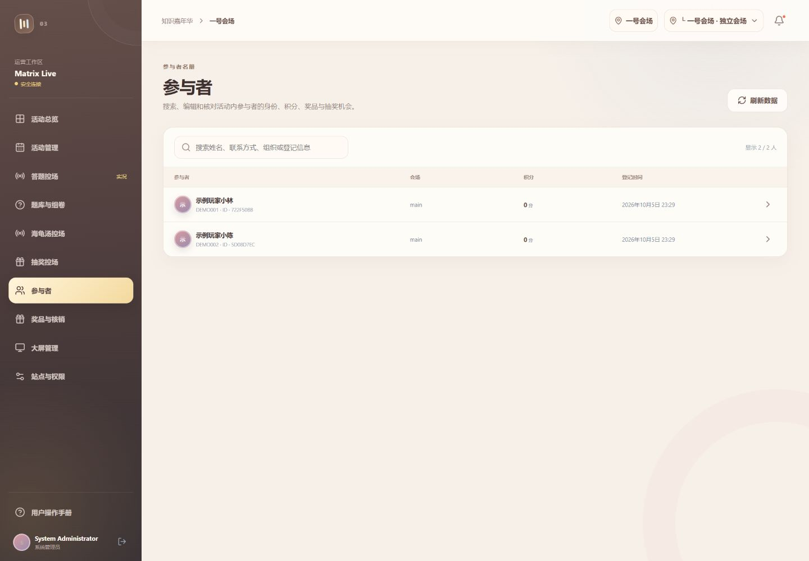

1. 选会场，点“参与者”。列表显示姓名、联系方式、会场、积分和登记时间。
2. 在“检索参与人信息”输入姓名、联系方式或其他资料关键词；点“刷新数据”重新读取。
3. 点某人的“查看并编辑参与者”图标打开档案。先核对联系方式，避免重名造成误操作。
4. 搜索不到时清空关键词，并检查自己是否选错会场；同一人在其他会场的记录分别管理。

完成后：显示人数与筛选结果一致，打开的是正确参与者。

## 31 修改参与者和调整积分

身份资料与积分调整会影响现场记录，保存前确认对象。

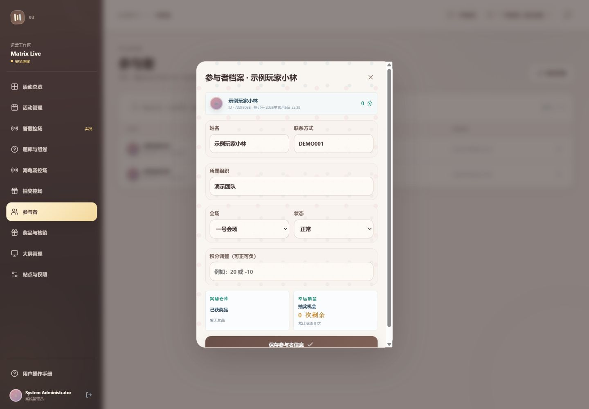

1. 档案中可修改姓名、联系方式、组织、登记入口和状态；停用人员不能正常参加相应操作。
2. 在“积分调整（可正可负）”填本次变化量，不是最终总分。例如当前 100 分加 20，输入 20；扣 10 输入 -10。
3. 查看已获奖品、待核销状态和剩余抽奖机会。扩展报名字段在档案里显示。
4. 点“保存参与者信息”，等待完成。返回列表检查资料和积分，勿重复提交同一次调整。

完成后：总积分按本次加减更新，历史答题分不应靠重复提交修改。

## 32 母活动海龟汤汤稿库

汤稿属于母活动，从母活动侧边栏管理，不在活动总览中直接编辑。

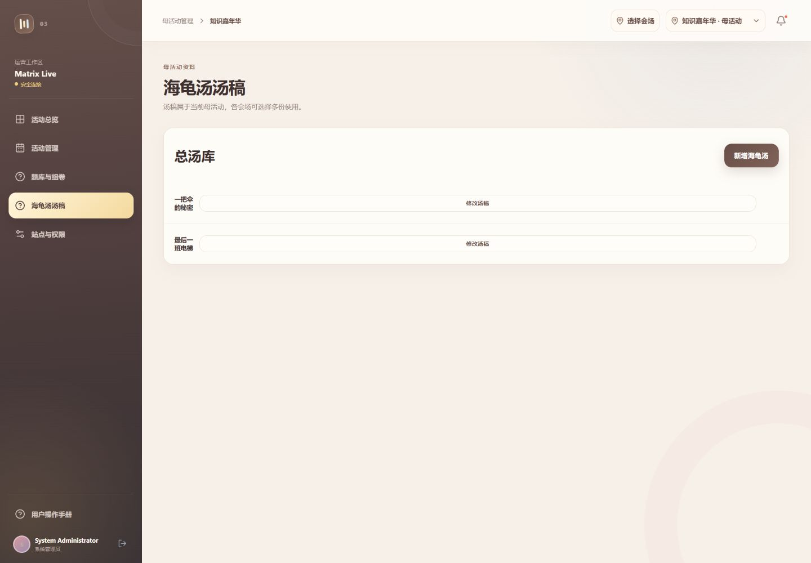

1. 上方“选择母活动或会场”选母活动，再点左侧“海龟汤汤稿”。
2. 点“新增海龟汤”建立新故事；已有故事点“修改汤稿”。同一母活动可保存多份。
3. 填写完整汤面、汤底和线索，检查谜题与真相能对应。汤底保存后由会场决定什么时候公开。
4. 母活动修改后，不要假定会场现有本地修改会被自动覆盖；到会场检查选用和当前内容。

完成后：总汤库列出该母活动故事，其他母活动资料分别管理。

## 33 新增和修改汤稿

汤面是给观众的谜题，汤底是完整解释，线索是逐步提示。

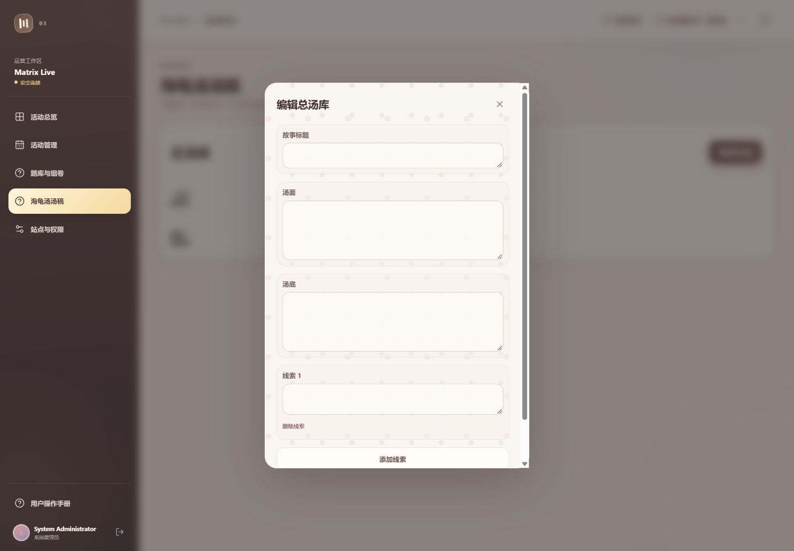

1. 填写“故事标题”“汤面”“汤底”。汤面保留悬念，汤底写清完整因果。
2. 点“添加线索”逐条填写，每条表达一个提示。最多五十条；不需要的条目点“删除线索”。
3. 保存前校对错别字和角色关系，避免主持人按错误线索误导观众。
4. 点“保存汤稿”并等待列表更新；关闭窗口前先保存。

完成后：新故事出现在总汤库，标题清晰，汤面、汤底和线索完整。

## 34 会场选用多个汤稿

每个会场可以从所属母活动勾选多份故事，分别安排使用。

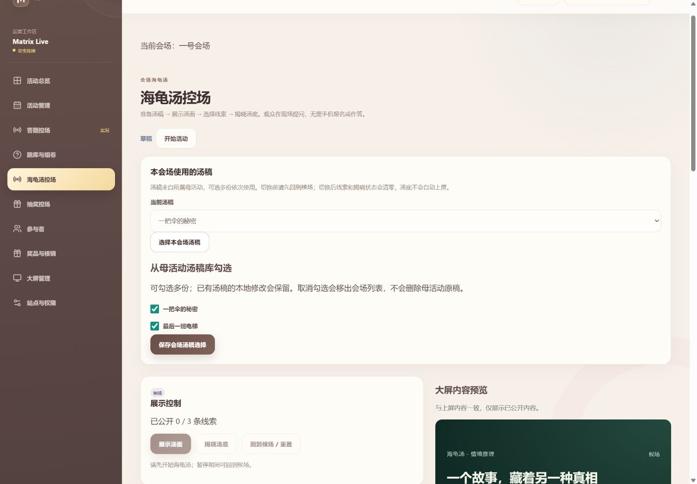

1. 选会场，进入“海龟汤控场”。点“本会场使用的汤稿”展开，再点“选择本会场汤稿”；候场时选稿区会自动展开。
2. 勾选本场要使用的故事，允许同时勾选多份；点“保存会场汤稿选择”。
3. 取消勾选只移出会场列表，不删除母活动原稿；已有会场汤稿的本地修改会保留。
4. 在“当前汤稿”下拉框确认可用故事，开场前检查至少有一份可用内容。

完成后：本会场下拉框只包含已选入会场的汤稿。

## 35 海龟汤开始与展示汤面

海龟汤是现场推理，不要求观众手机报名或提交答案。

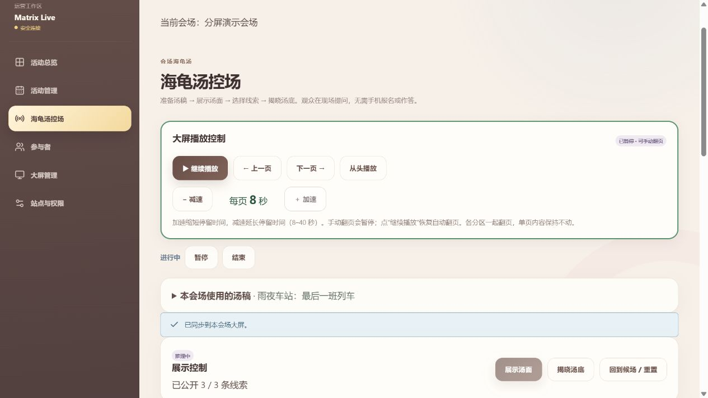

1. 选当前汤稿，检查故事和线索；页头为草稿时点“开始活动”。
2. 点“展示汤面”开始推理，大屏出现故事谜题。主持人按现场提问回应“是／否／无关”。
3. “大屏内容预览”只展示已公开内容。宽屏在右侧，手机窄屏在按钮栏下方；长内容在对应分区内自动翻页。
4. 需要休息可暂停；需要回到故事候场用“回到候场／重置”。重置会清空公开线索和揭晓状态。

完成后：大屏进入推理阶段，汤底仍未公开。

## 36 自由公开和撤回线索

线索不必按编号依次公开，可根据现场推理进度选择。

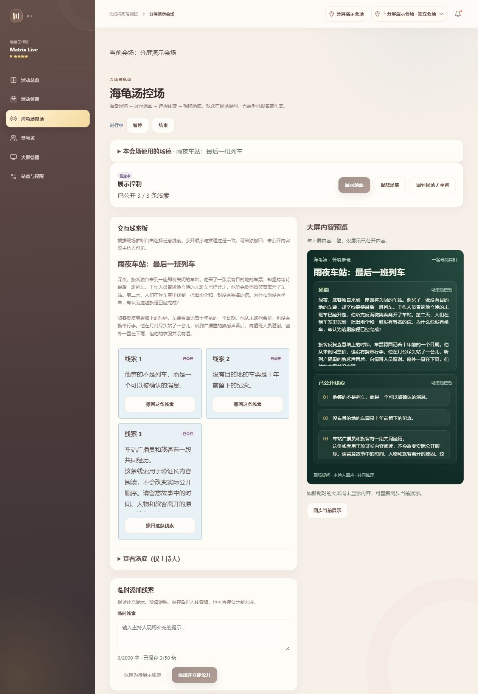

1. 在“交互线索板”阅读每条线索，点需要那条的“公开这条线索”。
2. 已公开线索显示“已公开”，大屏按实际公开顺序呈现；线索编号仍对应原稿条目。
3. 误公开时点该条“撤回这条线索”。其他已公开线索保留，观众屏随之更新。
4. “查看汤底（仅主持人）”只是展开工作人员参考，不等于向观众揭晓。不要把主持人电脑直接投给观众。

完成后：预览和大屏只显示目前公开的线索。

## 37 临时添加现场线索

临时线索用于补充提示和澄清误解，不必修改母活动原稿。

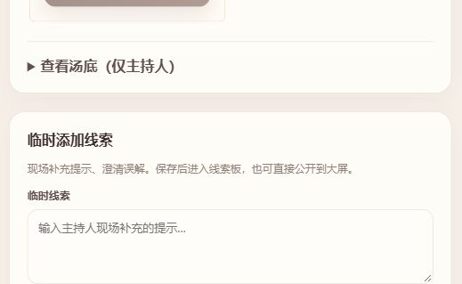

1. 向下找到“临时添加线索”，在文本框输入本次提示。单条最多 2000 字，总线索最多五十条。
2. “保存为待展示线索”只加入主持人的线索板，稍后再手动公开。
3. “添加并立即公开”会保存并上屏，只在当前推理阶段使用。点击前再读一遍。
4. 汤底已揭晓后不能继续追加推理线索；需要下一份故事时先回到候场。

完成后：新线索出现在板上，只有选择立即公开或后来公开时才让观众看到。

## 38 会场本地编辑汤稿

这里改的是当前会场使用的内容，不能当作母活动总汤库编辑。

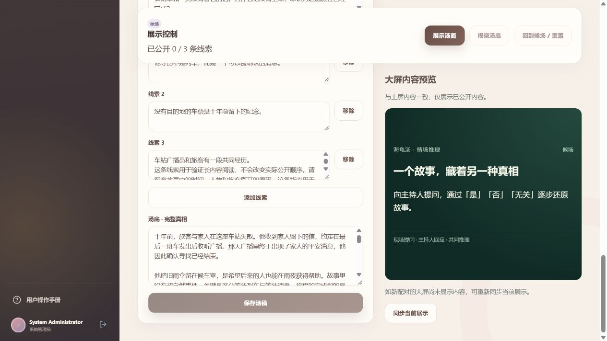

1. 点“回到候场／重置”后，向下找到并点击“编辑当前汤稿（仅本会场）”，展开后才会看到输入框。
2. 改故事标题、汤面、线索和完整真相。推理期间表单禁用，先回到候场再改。
3. 有“未保存的修改”提示时，先点“保存汤稿”。切换故事前不要留下未保存内容。
4. 保存后检查右侧预览，再点“展示汤面”。要修正所有会场共用资料，应回母活动汤稿库处理。

完成后：本会场内容按保存结果更新，母活动原稿和其他会场不会被本地编辑直接改动。

## 39 揭晓汤底前的确认

点击揭晓后，页面按钮栏会出现确认区域。揭晓会让所有观众看到完整真相，请在推理结束后操作。

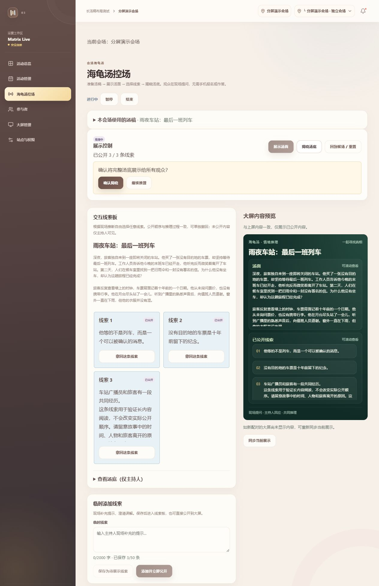

1. 点“揭晓汤底”。页面出现“确认将完整汤底展示给所有观众？”提示。
2. 还想继续推理时点“继续推理”；确实要结束故事时点“确认揭晓”。
3. 确认后，大屏显示“汤底／完整真相”。该阶段不再公开新的推理线索。
4. 检查大屏和预览已出现完整解释，再主持现场复盘。

完成后：只有点确认揭晓后，观众才看到汤底。

## 40 切换下一份汤稿

同一会场多故事不需要结束整场海龟汤环节。

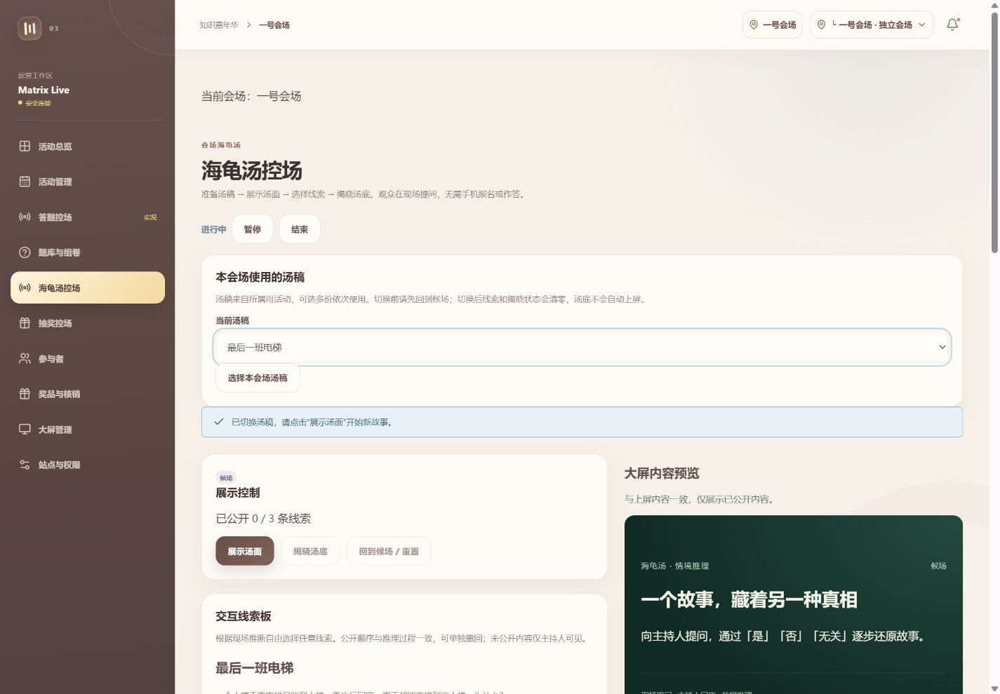

1. 完成上一份故事后点“回到候场／重置”。保存未保存的文字修改。
2. 点“本会场使用的汤稿”展开，在“当前汤稿”下拉框选择下一份故事；该故事应已选入本会场列表。
3. 切换会清空上一份公开线索和揭晓状态，不会把下一份汤底自动上屏。
4. 检查标题和内容，点“展示汤面”开始新故事。新屏未更新时可点“同步当前展示”。

完成后：看到“已切换汤稿”提示，下一份故事从候场开始。

## 41 海龟汤公开线索大屏

观众只看到主持人已经公开的线索。

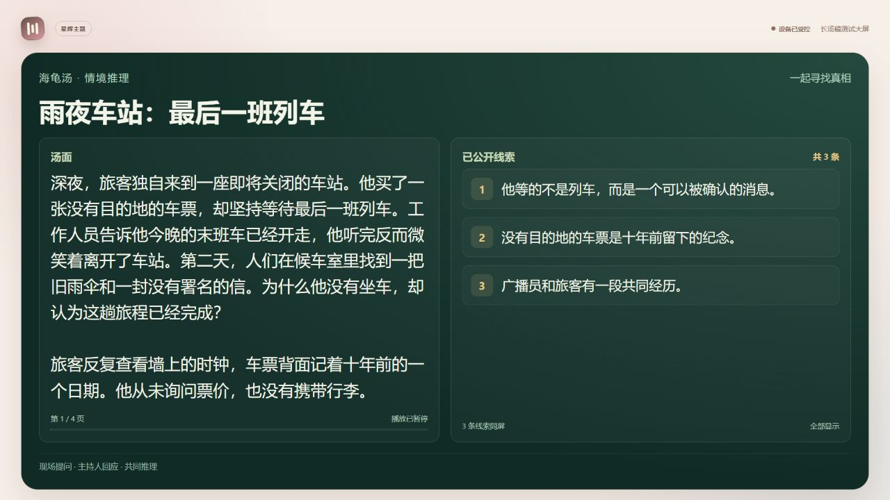

1. 显示汤面后到实际大屏检查故事标题和谜题内容。
2. 主持人公开一条线索后，确认它出现在观众大屏。
3. 撤回线索时核对大屏同步结果；未公开线索和主持人汤底不能提前展示。
4. 汤面和线索分区展示，长内容在对应区域里自动翻页。先让观众读完，再推进下一条提示。

完成后：公开故事和线索清楚可读，未公开资料保留在主持人侧。

## 42 海龟汤观众大屏

大屏只用于给观众展示公开内容。

1. 候场时显示玩法说明；展示汤面后出现标题和谜题。
2. 主持人公开线索后，屏幕逐条增加提示；撤回后对应提示消失。
3. 确认揭晓后出现完整真相。玩家无需在手机输入海龟汤答案。
4. 横屏揭晓后左边保留汤面和线索，右边展示完整真相。长文字在各自区域内自动翻页；播放控制在主持人端进行。

完成后：屏幕内容与主持人的当前公开阶段一致。

## 43 长汤稿自动分页播放

长文字自动分页，每页停留后切换，不需要在大屏上拖动滚动条。

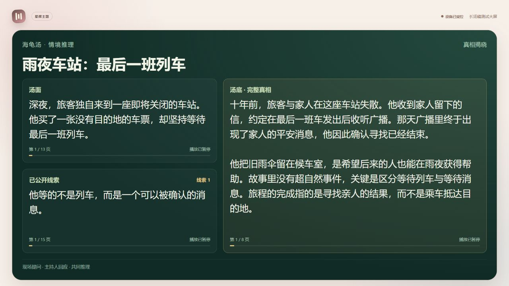

1. 汤面与公开线索分别显示。每块内容底部都有页码；短内容只显示一页。
2. 揭晓后左侧保留汤面和线索，右侧大区域播放完整真相。
3. 每页按主持人设置的秒数翻页。读得太快可点“减速”，需要讲解时点“暂停播放”。
4. 内容读完后自动循环；新公开线索会自动定位到对应线索。从头阅读时点“从头播放”。

完成后：长内容自动播放，标题和分区名称保留。

## 44 手机或窄屏怎么看海龟汤

窄屏自动上下排列，并根据实际空间分页。

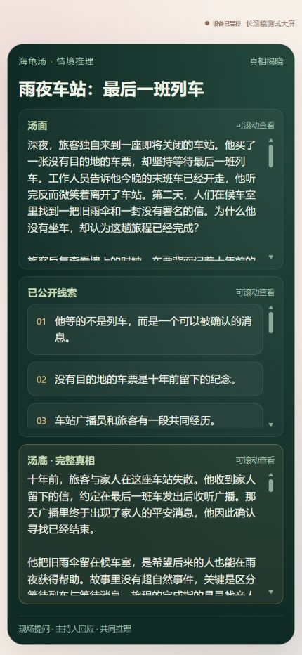

1. 上方核对故事标题，下面依次显示汤面、已公开线索和揭晓后的汤底。
2. 长内容会自动换页，底部显示当前页码，不需要上下滑动文字。
3. 短内容显示“完整显示”。需要停下阅读时，由主持人在后台暂停播放。
4. 屏幕大小不同，页数可能不同。观众仍按现场安排提问，不需要手机提交答案。

完成后：窄屏能够完整阅读当前页，无需手动滚动。

## 45 主持人怎么避免来回翻页面

现场常用按钮集中在“展示控制”。准备汤稿的区域可以收起，减少干扰。

1. 宽屏向下阅读时，“展示控制”保持在上方，仍可找到“展示汤面”“揭晓汤底”“回到候场／重置”。
2. 选稿区看不到输入框时，点“本会场使用的汤稿”展开。点同一个标题可以收起；候场时会自动展开。
3. 需要修改时，先回到候场，再点“编辑当前汤稿（仅本会场）”。修改后点“保存汤稿”，等成功提示再展示。
4. 线索很长时，在那张线索卡片里面滚动阅读；线索很多时，在整块线索板里滚动寻找。公开前看清对应内容。

完成后：常用控场按钮容易找到，准备资料不再占据大量页面空间。

## 46 主持人远程控制翻页

进入海龟汤控场，页面顶部就是“大屏播放控制”，无需先展开汤稿选择。

1. 默认自动播放。需要讲解时点“暂停播放”；讲完后点“继续播放”。
2. 点“上一页”或“下一页”会控制各分区，并自动暂停，方便读当前页。
3. 点“加速”缩短每页时间，点“减速”延长时间；旁边显示实际秒数，范围 8 至 40 秒。调速保留当前页；“从头播放”回到第一页。
4. 控制仅影响本会场。新接入或刷新的大屏会读取当前播放状态；预览尺寸不同，页数以实际大屏为准。

完成后：工作人员无需走到大屏电脑操作滚轮。

## 47 奖池列表与库存

奖池定义奖品、用途和库存，获奖记录是发给具体人员的结果。

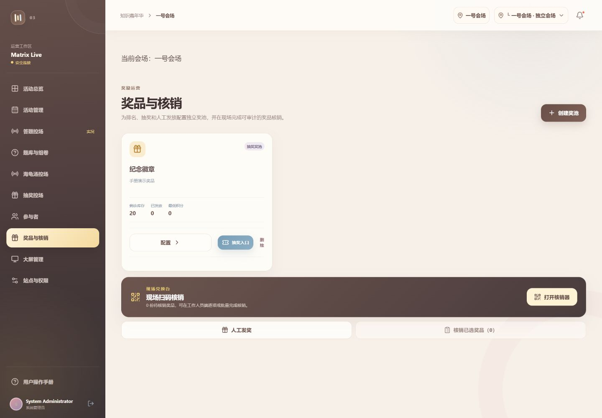

1. 选会场，点“奖品与核销”。每个奖池卡片显示剩余库存、已发放数量和最低积分。
2. 点“创建奖池”新建；已有奖池点“配置”修改。可区分人工、排名、摇奖／自助抽奖用途。
3. 奖池用途选项按当前会场功能显示。发放前检查用途、启用开关、剩余数量和交付方式。
4. 删除奖池前核对已有发放记录；活动现场优先停用不用的奖池，保留历史。

完成后：奖池库存足够且用途匹配，才继续发奖或抽奖。

## 48 创建和配置奖池

每个奖池保存一类奖励与相应规则。

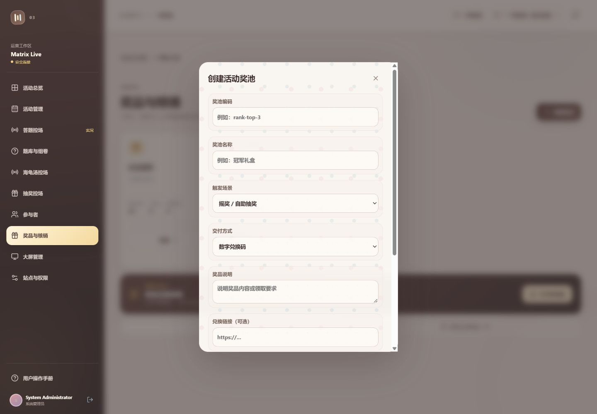

1. 填写唯一奖池编码和名称、奖品说明。编码用于识别，不建议使用含空格的随意文字。
2. 选触发场景：人工发放、积分排名、摇奖／自助抽奖；按页面出现的规则填名次区间或抽奖权重。
3. 选数字兑换码、兑换券或实物领取，按需填兑换链接。填写总库存和最低积分。
4. 勾“启用此奖池”，保存后检查卡片。改库存时核对已发放数量，不要让规则与现场奖品不符。

完成后：卡片显示正确库存与用途，启用后才能按相应流程使用。

## 49 人工发放奖品

人工发奖直接为选定人员生成领取记录，不能用作试点按钮。

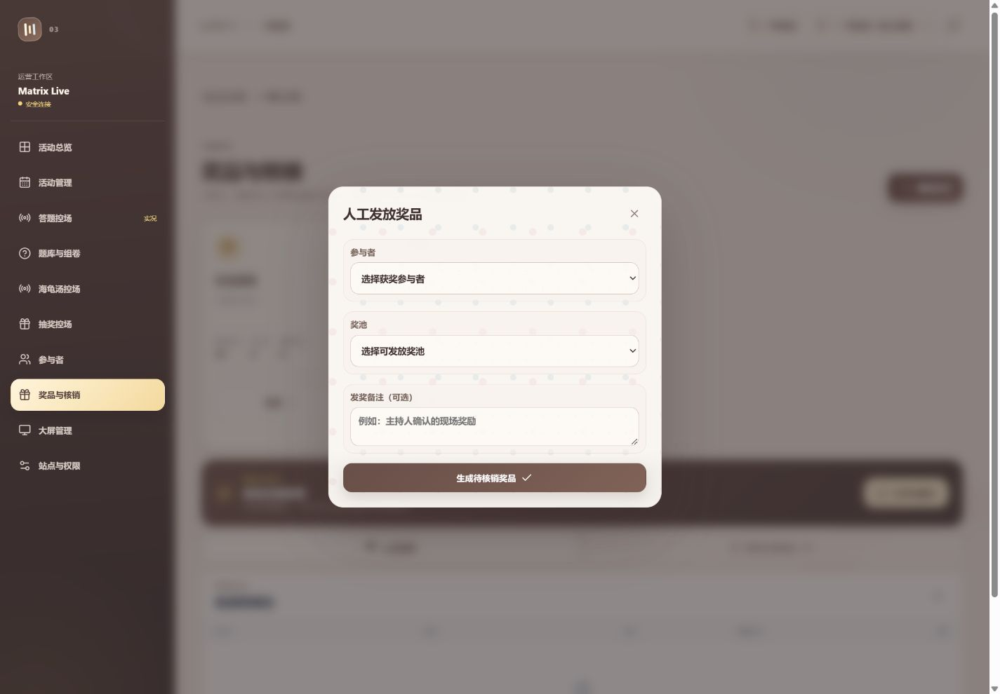

1. 点“人工发奖”，在“参与者”中核对姓名和积分，避免选错重名人员。
2. 在“奖池”选可发放且有库存的奖品；按需填写发奖备注。
3. 检查人员、奖池和用途后点“生成待核销奖品”。这是发放记录，不表示已经交付实物。
4. 生成后在核销台核对获奖人和奖品；实物交给本人后再核销。

完成后：对应人员有待领取记录，奖池库存相应更新。

## 50 按排行发奖

排名奖池要在最终积分核对完成后发放。

1. 创建积分排名奖池并设置“排名起／排名止”，例如第 1 至 3 名。
2. 先处理全部待评分和抢答判题，再发布积分榜核对人员和分数。
3. 在奖池卡片点“按排行发奖”，或按控场中的确认获奖流程操作；阅读确认内容再执行。
4. 发奖后到核销台核对实际获奖记录。名次和库存不足的问题要在交付前解决。

完成后：记录对应本会场最终积分排名及已配置名次区间。

## 51 抽奖入口和授予机会

自助抽奖入口和主持人摇奖不同：自助抽奖需要玩家已有抽奖次数。

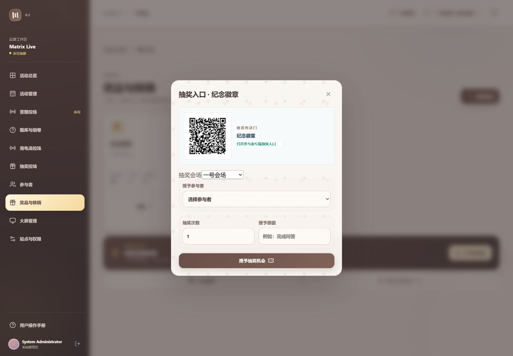

1. 在抽奖奖池卡片点“抽奖入口”。窗口中的二维码和“打开参与者专属抽奖入口”对应当前奖池。
2. 选择正确报名入口会场，再将该二维码展示给参与者。不要把工作人员后台地址当作玩家入口。
3. 要授予机会，在窗口选参与者、填写次数和原因，点“授予抽奖机会”。次数是新增机会，不是最终累计次数。
4. 玩家在指定入口检查剩余次数。没有次数、库存或未开始活动时按钮不能使用。

完成后：入口绑定正确奖池和会场，机会授予给正确人员。

## 52 开始抽奖环节

会场勾选抽奖只是开启功能；正式摇奖前还要开始抽奖环节。

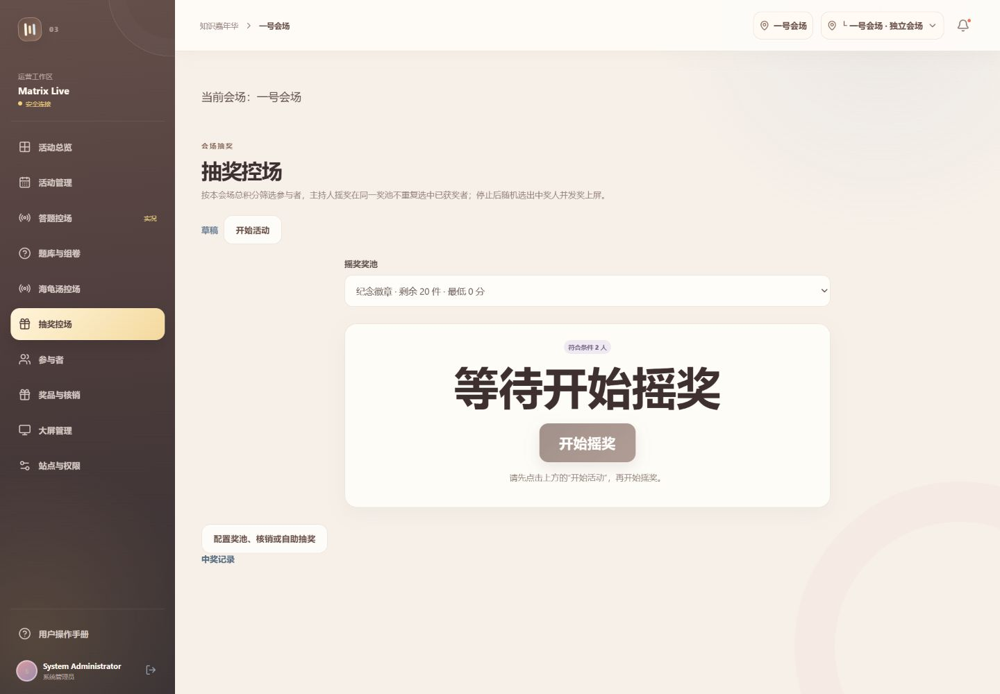

1. 选对会场，点左侧“抽奖控场”。核对当前状态和参与者人数。
2. 草稿状态点“开始活动”，等待状态更新；临时休息可暂停。
3. 从下拉框选择本次要使用的主持人摇奖奖池，核对库存和积分条件。
4. 没有可选奖池时先到“奖品与核销”创建正确用途的奖池，再回控场选择。

完成后：活动开始且奖池正确后，进入摇奖准备。

## 53 主持人摇奖准备

主持人摇奖按本会场积分和奖池条件筛选，和玩家自助次数分别处理。

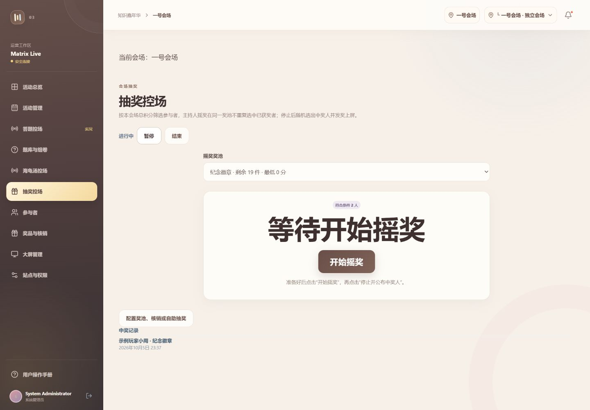

1. 左侧点“抽奖控场”。草稿时先点“开始活动”。上级会场和母活动也应已启用。
2. 选择摇奖奖池，核对剩余库存、最低积分和“符合条件”人数。
3. 同一奖池已获奖者不重复进入主持人候选名单；其他条件以当前页面提示为准。
4. 无奖池、未启用、发完或无候选人员时，按页面说明补齐条件后再开始。

完成后：“开始摇奖”可点击，候选人数和奖品与现场安排一致。

## 54 开始摇奖和公布中奖人

停止操作会确认中奖结果并生成奖品，请现场准备好后再执行。

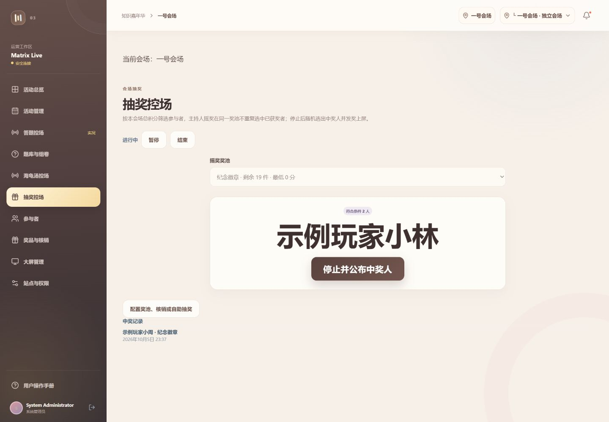

1. 点“开始摇奖”，姓名滚动显示。滚动中的名字不是已经确定的中奖人。
2. 主持人宣布停止时，点“停止并公布中奖人”。等待确认，不要连续点多次。
3. 成功后查看中奖人、奖品和“已生成领奖记录并同步到大屏”提示。
4. 在中奖记录和核销台核对，按交付方式办理领取；未确认成功时先刷新查看记录再重试。

完成后：最终记录中的获奖人和奖品才是本次有效结果。

## 55 认识核销台和领取记录

先找对领取记录，再核对本人和交付情况。

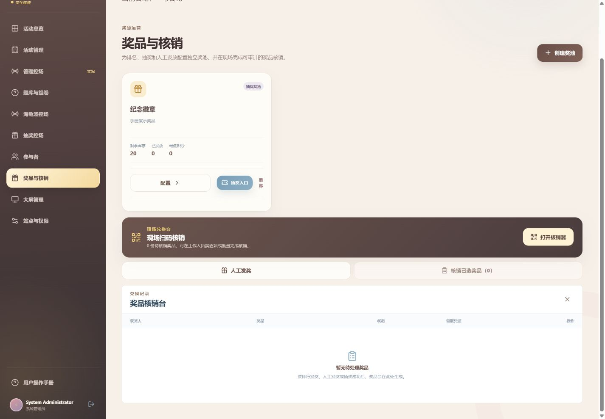

1. 选会场，点“奖品与核销”，向下找到核销台和领取记录。
2. 查看姓名、奖品、凭证和状态，区分未领取与已核销。
3. 需要单独发放时点“人工发奖”；需要交付时按现场流程核对记录。
4. 不要把生成获奖记录当作已经交付，也不要重复核销已领取记录。

完成后：能分清奖池库存、获奖记录和实际交付状态。

## 56 核销台逐项和批量核销

核销表示已经核对并交付，不是准备发奖。

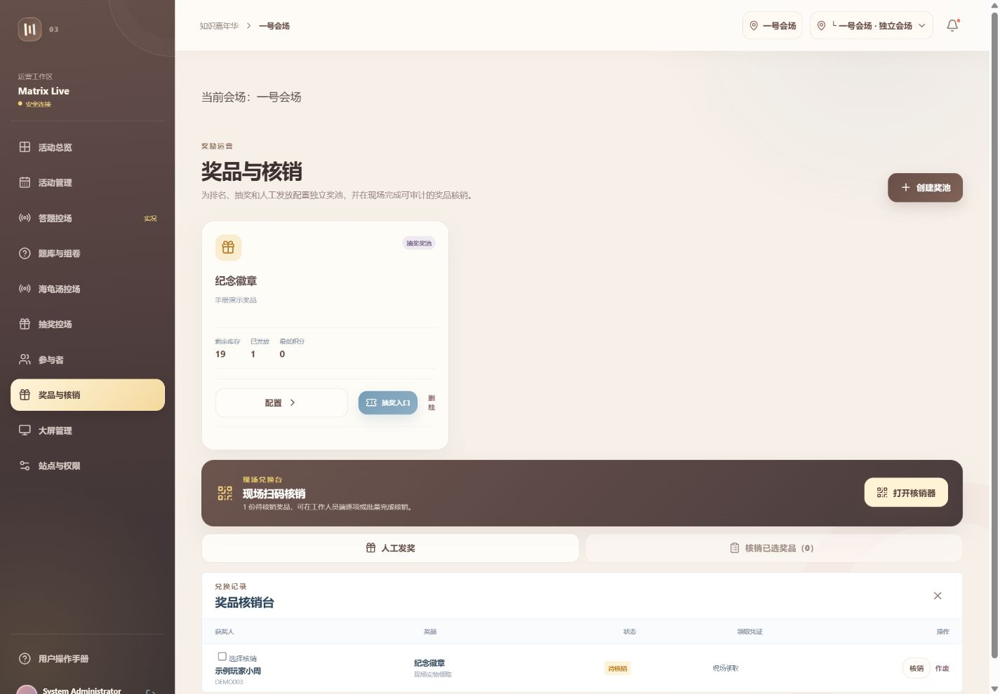

1. 点“打开核销器”，查看获奖人、联系方式、奖品、状态和领取凭证。
2. 实物先核对本人并交付，再点该条“核销”。数字或券类按实际交付流程核对凭证。
3. 要批量处理时勾选已确认交付的记录，再点“核销已选奖品”。不要把未交付的记录一并选中。
4. 核销后检查状态。需要作废或撤销核销时按页面入口核对原因和记录，不重复发放同一奖品。

完成后：已交付奖品显示已核销，待领取的继续保留待核销状态。

## 57 大屏管理和模板列表

每块屏幕都属于一个会场，可以分别控制。

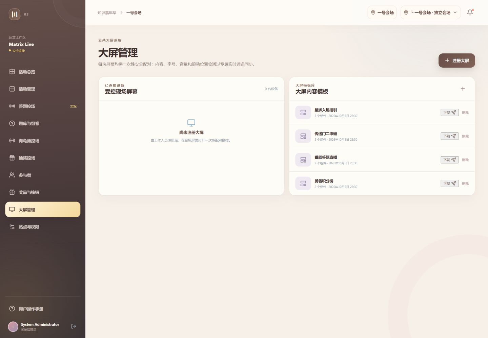

1. 选会场，点“大屏管理”。上方显示设备，下方显示可用内容模板。
2. 点“注册大屏”添加实际投影或显示器；点已有设备“管理”可改名字或删除设备。
3. 模板旁“下发”将相应内容发送到当前受控设备；题目、答案、积分榜等现场内容由控场操作同步。
4. 默认模板不能删除属于正常保护；自行建立的模板按页面按钮管理。

完成后：设备和内容都属于当前会场，不会因其他会场开题而切换。

## 58 注册大屏和安全配对

一次性配对链接用来认领目标设备，只交给现场屏幕工作人员。

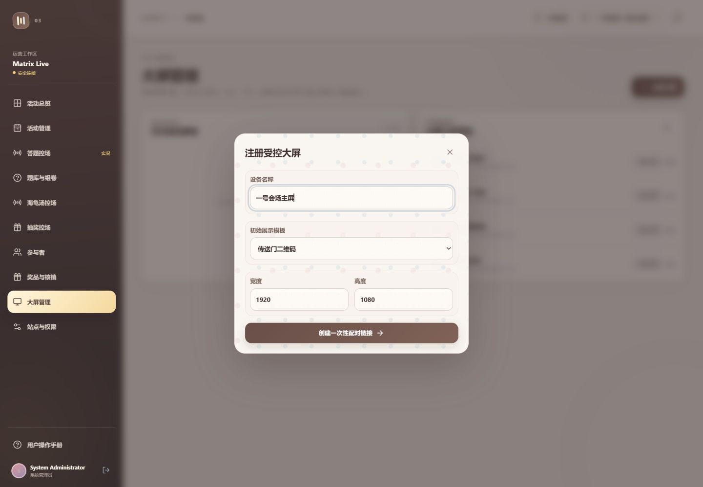

1. 点“注册大屏”，填写设备名称，例如“一号会场主屏”。选择初始模板。
2. 填写目标宽度和高度，常见横屏为 1920×1080；实际屏幕连接后会报告自己的尺寸。
3. 点“创建一次性配对链接”。在目标屏幕的浏览器打开链接，或扫描配对二维码。
4. 配对后地址移除一次性参数，页面显示设备已受控。观众报名请用报名二维码，不能用配对二维码。

完成后：目标设备出现在列表，屏幕右上角显示受控设备名称。

## 59 配对结果与重新配对

同一配对链接只用一次。失效时由工作人员重新生成。

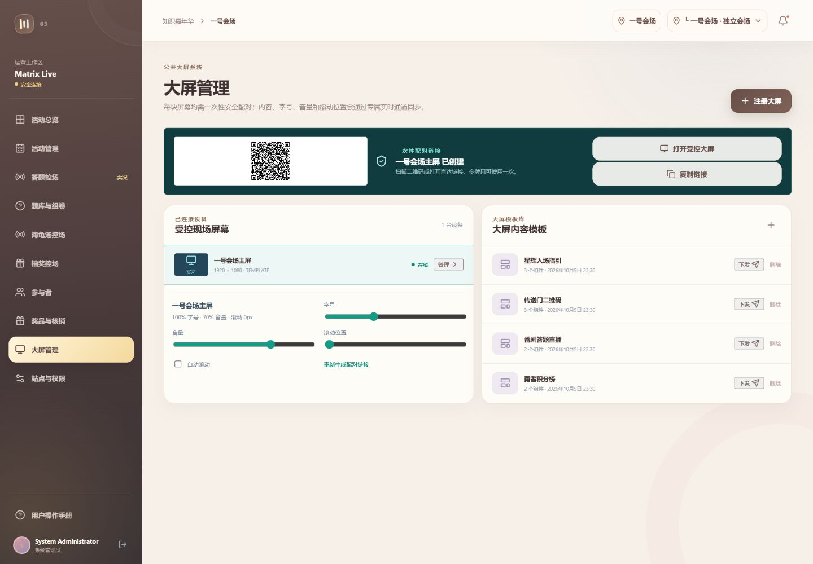

1. 确认页面显示设备已受控，并显示选定初始模板。第一次配对时检查屏幕名称。
2. 链接已用过、过期或换电脑时，点“重新生成配对链接”，再到目标设备打开新链接。
3. 重新配对会更换设备会话；不要同时把同一个认领链接分给多块屏幕。
4. 关闭浏览器或网络断开时，先检查网络，再核对配对状态；新屏尚未显示当前故事可同步当前展示。

完成后：真正观众屏能随主持人切换内容；仅后台显示设备行不等于投影已经正常。

## 60 字号音量滚动与设备名称

不同屏幕尺寸和观看距离需要分别调节。

1. 找到设备的字号、音量和滚动位置滑块，用鼠标拖动。观察实际屏幕，避免只看电脑预览。
2. 长内容可启用“自动滚动”。观众读完一段后再移动位置，不要快速滚过关键内容。
3. 点“管理”修改设备名称并保存。设备名应能辨别具体投影或显示器。
4. 删除设备会解除该设备使用；不再使用时核对名称再操作，必要时重新注册配对。

完成后：实际屏幕字号可读、声音适当，滚动位置覆盖完整内容。

## 61 管理和重命名大屏

设备管理窗口针对一块具体屏幕。

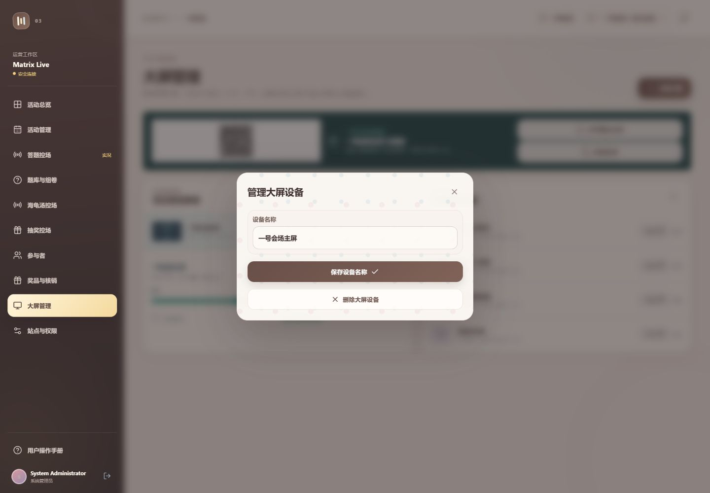

1. 在设备卡片上点“管理”，先核对窗口对应设备。
2. 修改名称为容易辨别的现场位置，例如“入口左侧屏”。
3. 点“保存设备名称”，回到列表确认名称已更新。
4. 设备不再使用时核对对象再删除；新设备需要重新注册和配对。

完成后：列表中的设备名称与现场位置一致。

## 62 新建大屏内容模板

模板适合候场说明、二维码、图片和文件等固定展示。

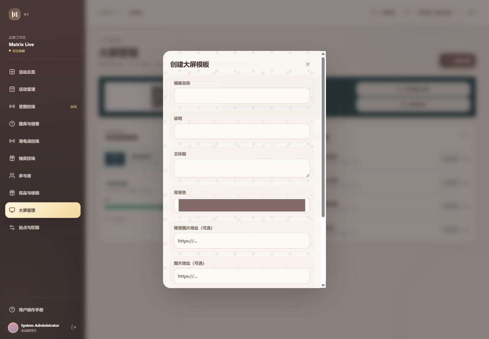

1. 点“新建模板”，填写模板名称、说明和主标题。名称要能看出用途，例如“入场扫码”。
2. 设置背景色、背景图地址和图片地址；有文件素材时填文件地址，先确认观众屏可以打开。
3. 按需勾“加入活动二维码”或“加入信息登记二维码”，避免给观众两个用途不清的二维码。
4. 点“保存模板”，然后在列表点“下发”。模板保存与现场下发是两步。

完成后：观众屏出现指定内容，二维码指向正确会场入口。

## 63 大屏候场报名二维码

观众扫描的是报名入口二维码，设备配对码只交给工作人员。

1. 在大屏管理找到入场二维码模板，点“下发”。
2. 到实际投影或显示器检查二维码完整、清晰，无遮挡。
3. 用手机扫码核对会场名称和登记页，确认观众能进入。
4. 现场提示观众扫码登记；开题后由控场切换题目显示。

完成后：候场观众能扫描本会场的报名入口。

## 64 大屏报名二维码和答题展示

观众屏需要保持在公开展示页，不能用工作人员后台代替。

1. 候场可下发入场或二维码模板，让观众扫码登记。二维码旁说明应与入口用途一致。
2. 主持人开题后，大屏显示题目、选项、倒计时和已提交人数。玩家用自己的手机提交。
3. 倒计时结束后等待主持人公布；公布答案后高亮正确选项，提示等待下一题。
4. 发布积分榜后，大屏改为排名。素材和字号问题先在大屏管理检查。

完成后：大屏显示的阶段与主持人当前操作一致，不在结束后继续要求提交。

## 65 大屏公布答案

答案展示由主持人统一发布，观众手机反馈和大屏展示分别核对。

1. 主持人在答题控场确认本题已完成，点“公布答案”。
2. 观察大屏正确选项高亮和等待下一题提示。
3. 有答案说明或素材时给观众留出阅读时间。
4. 讲解完成后回控场选择下一题并开题，不要让玩家继续提交已结束题目。

完成后：大屏能辨别正确选项，现场进入讲解或下一题。

## 66 报名入口配置

这里是本会场的登记入口设置，不是新建另一个独立会场。

1. 选会场，进入“站点与权限”，找到“报名入口配置”。点新增，或点已有入口编辑。
2. 填写会场名称和入口代码。代码用于识别该入口，填写前先确认未重复。
3. 需要人数限制时填登记容量；留空表示页面定义的不限容量。勾“允许参与者登记到此会场”启用。
4. 保存后检查入口状态，再用观众报名页试开。关闭入口会影响登记，但不是删除已有人员。

完成后：观众报名页只显示可用入口；唯一可用入口自动选中。

## 67 扩展报名字段

姓名、联系方式和组织是固定字段；其他信息可用扩展字段收集。

1. 在“报名字段模板”点“新增报名字段”。填易懂的字段名称和唯一字段代码。
2. 选输入类型：TEXT 短文本、TEXTAREA 长文本、EMAIL 邮箱、PHONE 联系方式、NUMBER 数字。
3. SELECT 下拉、RADIO 单选、CHECKBOX 多选需要按窗口填写可选内容；设置显示顺序、是否必填和是否展示。
4. 保存后打开玩家报名页核对。如果字段禁用，观众不再看到该字段；旧记录仍需按档案核对。

完成后：报名页字段名称、选项、顺序和必填规则与设置一致。

## 68 会场成员授权

工作人员只有相应会场权限，才能操作该会场；系统管理员负责全局管理。

1. 选需要分配人员的会场，进入“站点与权限”，向下找到“当前会场成员”。
2. 选已有账户，角色选活动管理员或活动工作人员，点“授予”。新增账号时会按当前范围配置成员关系。
3. 活动工作人员主要做控场、人员处理和评分；活动管理员还负责资料配置和成员管理，具体按钮受权限控制。
4. 移除权限前核对会场和账号。仅有母活动资料权限不会自动得到所有会场操作权限。

完成后：该工作人员登录后能看到被分配的会场；未分配会场不能操作。

## 69 新增工作人员账号

通常由管理员为工作人员建立独立账号，不共用一个账号操作。

1. 先选要工作的会场，点“新增会场成员”。填写登录名、显示名称和初始密码。
2. 角色按职责选择活动工作人员或活动管理员；系统管理员账号应由负责全局的人员使用。
3. 点“创建账户”，等待成功。将登录网址和本人账号交给对应工作人员。
4. 让工作人员重新登录核对会场和菜单；看不到会场时回成员列表检查，不必再次重复建账号。

完成后：账户和会场成员关系正确，工作人员能进入自己的会场。

## 70 编辑账号和密码

账号管理与会场授权是不同操作。

1. 在“用户账户”找到该人，点“编辑账户”。可以改登录名或显示名称。
2. “新密码（留空则保持不变）”留空不会重置密码；需要改密码时由有权管理员输入并交给本人。
3. 点“保存账户”后让本人核对登录信息。不要将密码写在公开手册、截图或群公告中。
4. 更换显示名称不等于授予会场权限；增加或移除会场访问要在成员列表操作。

完成后：账号资料保存正确，权限仍按会场成员关系控制。

## 71 站点基础和参与端品牌

全站名称与某个会场的品牌分别配置。

1. 系统管理员在“站点基础设置”填写域名、站点名称、Logo 地址和页脚内容，点“保存站点设置”。
2. 在“参与端活动品牌”配置当前项目的显示名称、主题色、头图和背景图，可用地址或上传图片。
3. 点“保存参与端品牌”，打开对应玩家入口核对。不同会场需要不同外观时分别选择和保存。
4. 不要只修改浏览器地址或文件名来更改品牌；以页面保存结果为准。

完成后：全站入口和当前会场参与页显示预期名称及图片。

## 72 素材存储设置

此页通常交给维护人员。没有可用存储时，媒体上传可能失败。

1. 系统管理员找到“S3 静态文件存储”，启用上传，并按实际服务填接入点、区域、桶名称和寻址方式。
2. 填写 Access key、Secret key，临时凭证按需填会话令牌。密钥保存后不会再次完整展示。
3. “清除已保存密钥”会清除凭证，不是普通的清空输入框。修改前由维护人员确认。
4. 保存后用小图片试上传并在手机、大屏确认能读取；不要将密钥截图发给活动群。

完成后：保存信息与真实存储一致，上传和显示都成功。

## 73 玩家公共会场选择页

没有直接会场二维码时，从公共列表找到现场会场。

1. 打开工作人员提供的参与者网址，进入“选择会场”页面。
2. 按母活动标题找到自己参加的会场，点对应会场行。
3. 核对名称，按页面选择会场开放的功能并登记。
4. 找不到会场时向现场工作人员确认是否开放，不要随意加入其他会场。

完成后：进入正确会场的参与页。

## 74 玩家选择会场和报名

观众扫码进入本会场，或先在公共列表选择会场。

1. 扫码或打开参与者入口。公共列表先点自己所在会场，核对页面会场名称。
2. 只有一个可用报名入口时自动选好；有多个时按现场工作人员说明选择。填写姓名和可识别联系方式。
3. 填写必填扩展字段，再输入图片验证码。看不清点“换一张验证码”，使用新图片中的字符。
4. 点“完成登记”，等待身份确认成功。未提交成功时保留联系方式，按提示查询，不要换名反复登记。

完成后：显示已完成现场身份确认，可使用会场已开放功能。

## 75 已登记身份查询和退出

更换设备或重新进入时，可以用原联系方式找回本会场身份。

1. 在登记页点“查询已登记的参与信息”。填写当时使用的联系方式和当前验证码。
2. 点“查询并继续参与”，等待恢复。查不到先核对会场和联系方式，不要改用别人的信息。
3. 登记页提示验证码失败时换一张重试；提示已经登记时使用查询入口。
4. 共用手机或要换参与者时点“退出当前参与身份”。退出不是删除报名资料。

完成后：恢复后姓名和本会场积分正确。

## 76 玩家选择会场功能

登记身份在本会场开放功能间共用，不需要每换一项重新报名。

1. 会场主页点“答题”等功能入口。未开启或未开放的功能不会作为可用入口出现。
2. 上方“选择参与活动”可切换会场或已开放功能。先核对名称，再进行操作。
3. 底部导航可看排行、奖励和我的信息；手机上固定在下方，正文可上下滑动。
4. 海龟汤通过现场提问参与，观看大屏，不需要手机提交答案。

完成后：进入的功能属于自己所在会场。

## 77 玩家等待主持人开题

活动已开始，也可能暂时没有可提交的题目。

1. 先确认页面显示已经完成身份登记。
2. 出现未开题、等待或不可提交提示时，保持页面打开并听主持人安排。
3. 题目开放后检查倒计时，再选择答案并确认提交。
4. 长时间没有变化时检查网络和会场；不要为等题而重复报名。

完成后：主持人开题后页面进入可作答状态。

## 78 玩家普通答题

开题后先选择，再点击确认。只点选项还不算提交。

1. 等待题目和倒计时出现。单选点一个选项，多选勾所有认为正确的选项。
2. 上下滑动页面找到“确认提交”，在倒计时结束前点击。按钮提交期间会显示正在确认。
3. 提交成功后看反馈。网络异常时先看页面提示和已提交状态，不要反复点提交。
4. 倒计时结束、暂停或答案公布后无法再提交本题，等待主持人下一步。

完成后：页面出现答题结果或待评分说明。

## 79 玩家查看答题结果

答题反馈与本题积分变化显示在题目下方。

1. 查看回答正确、部分正确、错误或待评分。正确并不一定等于满分，分数取决于活动计分规则。
2. 查看本题提交顺序和积分变化；页上方显示累计积分。
3. 答案公布后可查看标准选项或答案材料。等待下一题即可，无需一直刷新。
4. 对积分有疑问时，将会场、姓名、题目和提示交给工作人员核对。

完成后：本题反馈和总积分更新一致。

## 80 玩家文本题

文本题需要填写文字，不使用选项按钮。

1. 在输入框写清自己的回答，注意题目要求；不要只输入无关的姓名或联系方式。
2. 在截止前点“确认提交”。提交成功后按给分方式显示结果或等待评分。
3. 人工评分需要工作人员处理，暂未加分不表示没有提交成功。
4. 收到反馈后查看说明及积分变化。题目关闭后不能再补交文字。

完成后：文字回答已提交，等待评分或出现判题结果。

## 81 玩家抢答

抢答成功只代表取得顺序，分数由主持人现场判题。

1. 题目开放后点“抢答”。同一题不要重复点。
2. 成功后查看“第几位”，等待主持人安排现场回答。
3. 主持人判对或判错后，手机显示对应积分反馈。
4. 题目未开放或时间已结束时不能抢答；等待下一题。

完成后：显示抢答顺序，随后收到主持人判题结果。

## 82 玩家查看积分榜

排行榜显示当前会场、当前功能的累计积分。

1. 完成登记后，点页面底部“排行”。
2. 查看列表中的姓名、名次和积分，找到自己的记录。
3. 人工评分、抢答判题和工作人员调整积分后，排行榜会更新。
4. 发现积分疑问时告诉工作人员具体题目和提交情况，等待核对。

完成后：能看到本会场积分排名和自己的累计积分。

## 83 玩家查看我的信息

个人信息页用于核对本会场身份和分数。

1. 点底部“排行”查看累计积分榜；分数可随人工评分、抢答判题或积分调整变化。
2. 点“我的信息”查看姓名、联系方式、会场、参与编号、积分和扩展字段。
3. 资料有误时联系工作人员；不要用退出和重新报名来绕过已有记录。
4. 需要重新读取时点个人信息中的刷新图标，保持网络连接。

完成后：姓名、会场和积分与本人登记资料一致。

## 84 玩家查看暂无奖励的状态

没有获奖记录或没有抽奖次数时，奖励页会说明当前情况。

1. 在手机底部点“奖励”，核对当前功能和会场。
2. 查看领取记录区域：暂无记录表示当前范围未发放奖品。
3. 查看抽奖次数；零次时等待工作人员授予机会，不能反复点击绕过限制。
4. 已有奖品但此页找不到时核对是否进入了对应抽奖功能或指定奖池入口。

完成后：能区分暂无奖励、已有奖品和剩余抽奖次数。

## 85 玩家奖励和自助抽奖

领奖信息和抽奖次数在奖励页显示，指定入口只对应指定奖池。

1. 点“奖励”查看奖品名称、领取方式和状态。实物按提示去现场领奖处，数字奖励按对应凭证办理。
2. 自助抽奖先由工作人员授予机会，并打开正确奖池入口。剩余零次时按说明等待安排。
3. 有次数且条件满足时点“开始抽奖”，等待结果；不要在请求未完成时连点。
4. 无奖励记录时表示当前范围暂无记录，不是页面损坏。领奖后工作人员核销，状态随之更新。

完成后：奖品和剩余机会对应当前会场功能及入口奖池。

## 86 结束活动和保留记录

结束是正式关闭，不能像暂停一样继续恢复。

1. 先完成待评分、积分核对、中奖和交付记录，再决定结束哪个环节。多轮答题或故事没完成，不要提前结束。
2. 只暂时休息用“暂停”；恢复后根据控场提示重新开题。
3. 结束母活动会关闭其下属会场和功能。只结束一个会场时核对对应行，不影响其他会场安排。
4. 题目、汤稿、人员、积分和奖品记录保留。下一场需要继续开展时创建新的会场安排，不依赖重开已结束项目。

完成后：现场停止接受相应操作，历史记录仍可核对。

## 87 查看手册和排查问题

先看会场名称，再看权限、功能开关、活动状态和网络。

1. 左侧“用户操作手册”打开本手册；可下载后发给工作人员，手机可放大查看图片。
2. 没有会场或菜单：请管理员检查会场成员和功能勾选。同步按钮灰色：检查答题草稿和管理员权限。
3. 无法切换汤稿：先回候场、保存文字并确认故事已选入会场。提示别人已更新：刷新状态后重新核对再操作。
4. 大屏不动：检查同一会场、目标设备配对、网络和当前展示；报名失败：检查入口启用、容量和验证码。

完成后：反馈问题时说明会场、页面、点击的按钮和完整提示，不发送密码或密钥。
