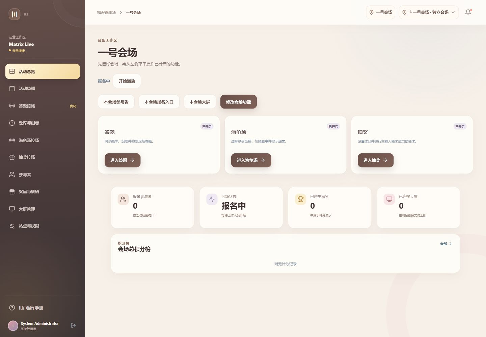
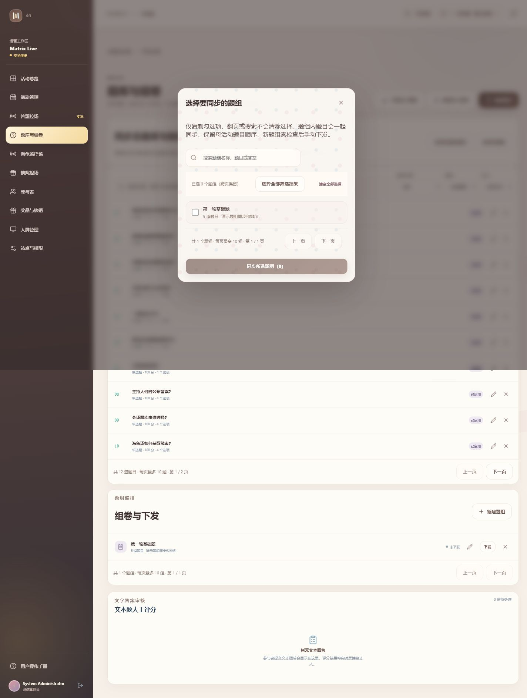
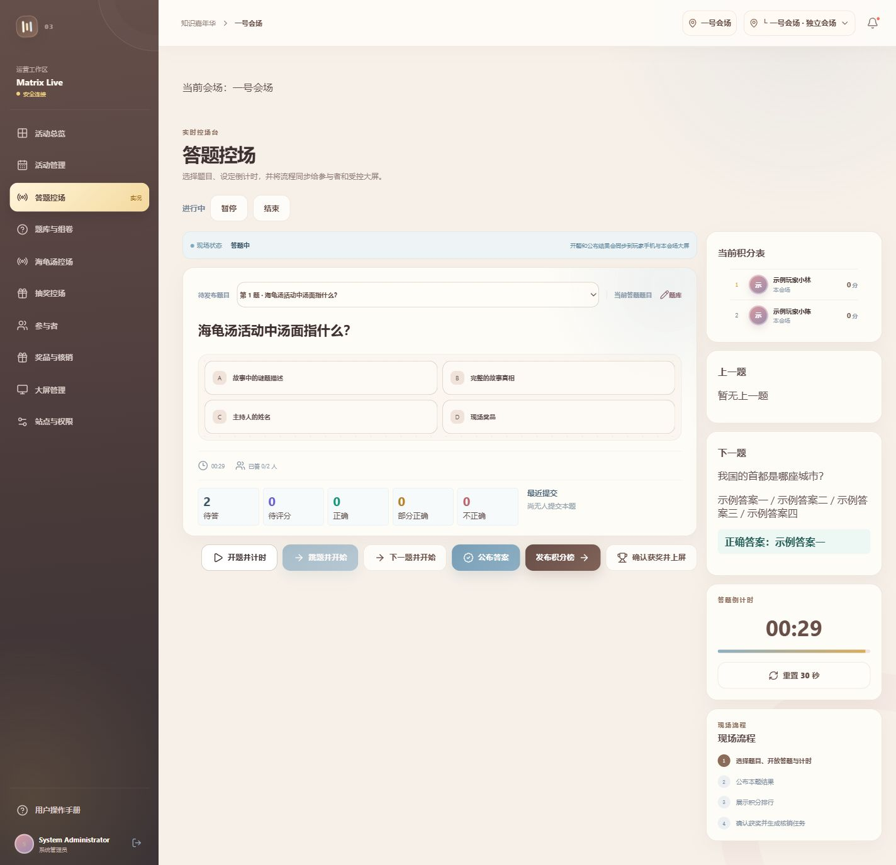
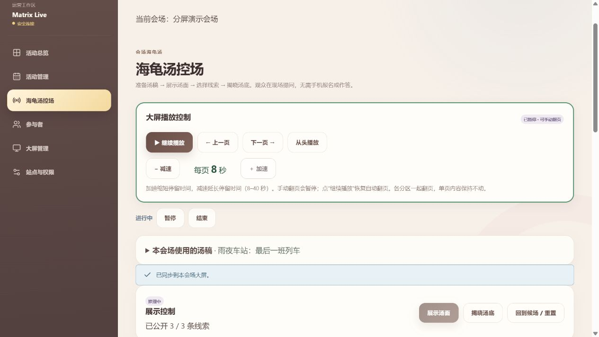
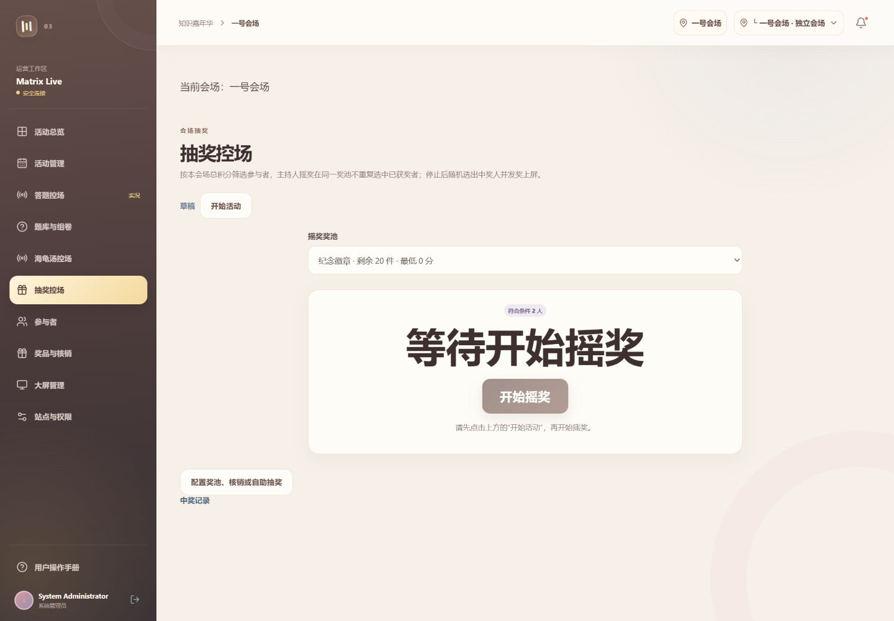
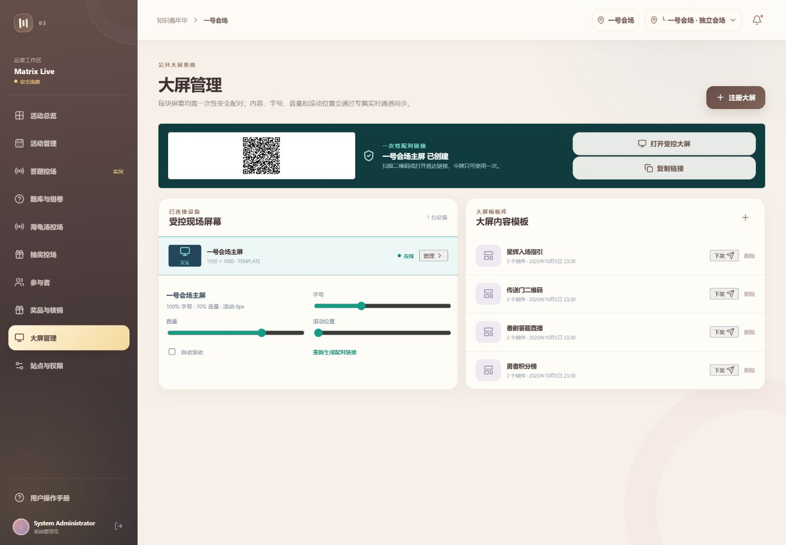
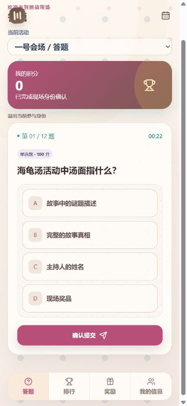

# 知识挑战赛简明操作手册

版本：2026 年 10 月 6 日。按需要阅读，不必从头背诵。

## 1. 登录与准备会场

先选对会场，再做任何操作。

1. 打开后台网址，填写工作账号和密码，点“安全登录”。账号由管理员提供。
2. 上方选择自己负责的会场。左侧菜单只显示本会场可用的功能。
3. 新建活动时，先建母活动，再建会场；创建会场时勾选答题、海龟汤或抽奖。
4. 母活动存放公共题库和汤稿；观众报名、展示和现场操作都在会场进行。

开场前检查：会场名称正确、功能已开启、资料已保存。

## 2. 题库与题组

公共题目先在母活动准备，再由会场选择同步。

1. 选母活动，进入题库，新增或修改题目，填写题目、选项和答案后保存。
2. 题目多时，用标题、题目内容或答案搜索。每页最多十题，可翻到下一页。
3. 切回会场，同步需要的题目或题组；确认勾选内容后保存。
4. 组卷时选择需要的题目。需要打乱出题顺序时，使用题组中的随机排序功能。

到会场题库再检查一次：本场需要的题目和题组都在。

## 3. 现场答题

按“开题 → 收题 → 公布答案 → 下一题”的顺序操作。

1. 选会场，进入答题控场，确认题组、题目和计分设置，再开始活动。
2. 选择本题并开题，让观众在手机作答。开题后注意倒计时。
3. 作答结束后收题，再公布答案；留出时间讲解，然后选择下一题。
4. 有人工评分的文本题，到评分页面完成评分；结束前核对积分榜。

开题前看清题目，公布答案前确认作答已结束。

## 4. 海龟汤

观众在现场提问，主持人回应，不需要手机提交答案。

1. 母活动侧边栏准备汤稿；切到会场，展开“本会场使用的汤稿”，选入本场故事。
2. 选择当前汤稿，开始活动，再点“展示汤面”。按现场提问回应“是、否、无关”。
3. 需要提示时，在对应线索卡片上公开或撤回。推理结束后点“揭晓汤底”，再点“确认揭晓”。
4. 顶部“大屏播放控制”可暂停、继续和手动翻页；用“加速／减速”调整每页秒数。换稿前先回到候场。

“查看汤底（仅主持人）”供主持人参考；确认揭晓后才给观众看。

## 5. 抽奖与领奖

先准备奖品，再抽奖，最后核对领取。

1. 在本会场的奖品页面创建奖池，检查奖品名称、数量、启用状态和用途。
2. 进入抽奖控场，确认本次奖品与参与名单，按页面按钮开始抽奖或摇奖。
3. 公布结果后给观众时间确认。自助抽奖需观众有对应会场的抽奖机会。
4. 观众领取时进入核销台，查找领取记录并核对信息，确认交付后再核销。

不要给同一条领取记录重复发奖。

## 6. 让大屏显示内容

投影观众大屏，主持人后台留在工作人员电脑上。

1. 选会场，进入大屏管理，注册实际使用的屏幕。
2. 用一次性配对链接在大屏电脑上打开页面，等待配对成功。
3. 现场核对会场名称、二维码和题目是否清楚。看不清时在该设备设置里调整字号。
4. 海龟汤会自动翻页，无需开启设备自动滚动。播放快慢在主持人端调整，不要修改其他会场的设备。

正式开始前，用实际投影或显示器试播一次。

## 7. 观众怎么参加

用手机扫描现场会场二维码，先核对会场名称。

1. 填写页面要求的姓名和联系方式，完成验证码，再确认登记。
2. 等主持人开题。题目开放后选择答案或输入文字，再点提交。
3. 提交成功后等待结果，不要连续重复提交。进入积分榜可查看当前成绩。
4. 需要领奖时打开奖励页，按领取信息联系工作人员。海龟汤直接按现场安排提问。

一个会场的登记身份不能用来操作另一个会场的活动。

## 8. 遇到问题先看这里

先检查会场、状态和提示，再决定怎么处理。

1. 找不到功能：检查是否选对会场，以及该会场是否勾选了这项功能。
2. 按钮不能点：看页面提示；活动可能未开始、已暂停，或有未保存的修改。汤稿编辑和切换要先回候场。
3. 大屏没有更新：检查配对和网络；海龟汤可点“同步当前展示”。页面提示连接异常时点“重新连接”。
4. 找不到题目或人员：清除搜索条件、翻页，并检查所属会场。仍不清楚时联系管理员。

工作结束后退出登录。不要把后台账号或主持人参考汤底发给观众。
